# yourbatis

**English** | [简体中文](README.zh-CN.md)

MyBatis-style dynamic SQL for Go, compiled into ordinary Go code.

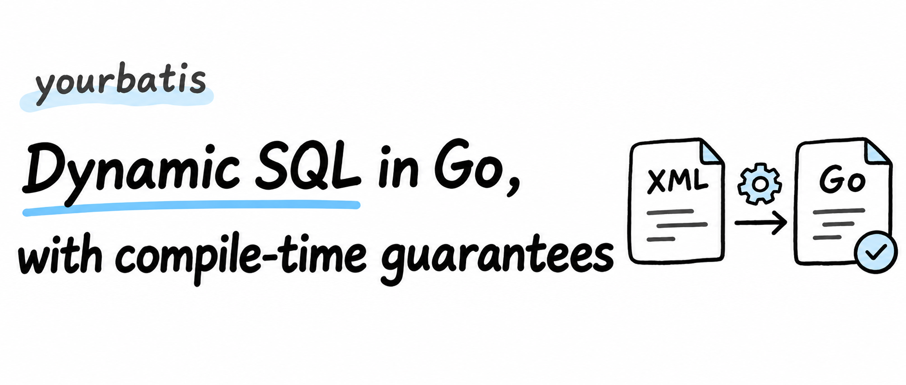

## Quick start

Try the complete SQLite example included in the repository:

```bash
go generate ./example/user
go test ./example/user
```

Read the [generated Mapper](example/user/user_mapper.sqlmap.gen.go), the [detailed usage guide (Chinese)](docs/usage.zh-CN.md), or the [JetBrains plugin instructions (Chinese)](jetbrains-plugin/README.md).

PostgreSQL and SQLite are primary targets. MySQL is a secondary target for CRUD, transactions, dynamic SQL, result mapping, affected-row counts, and auto-increment IDs. MariaDB and other databases are unsupported. See the [DML result contract (Chinese)](docs/dml-result-support.md) for dialect-specific modes.

## Why yourbatis?

If you have used MyBatis, you probably understand why we like it: you write SQL directly and organize complex queries the way you need. Optional conditions and batch operations can be expressed with `<if>`, `<where>`, and `<foreach>`. SQL and its dynamic logic stay together, so reading a Mapper tells you what it queries and how.

In Go, we had not found a framework that felt as capable and comfortable for writing SQL. With an ORM, implicit behavior makes it hard to see the SQL behind a method call. A query builder splits a query across scattered method calls. sqlc preserves handwritten SQL and offers code generation, but composing dynamic queries is less flexible than with MyBatis.

So we built yourbatis to bring the dynamic SQL experience we like in MyBatis to Go, combined with Go's code generation tools. You define an interface and write Mapper XML; `go generate` compiles them into ordinary Go code. Conditions and loops become `if` and `for`. The generator checks parameters, fields, and mappings, and the Go compiler checks the types in the generated code.

yourbatis grew out of our work on [OMA](https://github.com/superduck-ai/open-managed-agents), a cloud-hosted agent platform. It is the only SQL framework used by that project, and its design and implementation came from our needs there.

The project covers most commonly used MyBatis features. We will start with a familiar search requirement, then discuss the tradeoffs and implementation. The code is open source: [github.com/superduck-ai/yourbatis](https://github.com/superduck-ai/yourbatis).

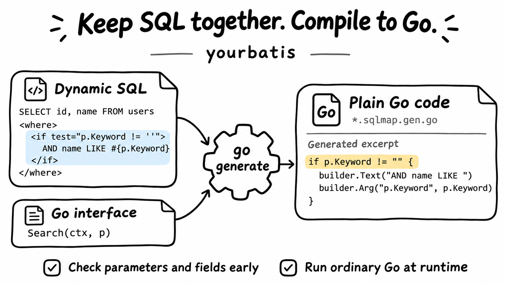

## One method, different SQL

A list with optional filters is one of the most common uses of dynamic SQL. Consider a user search:

```go
type SearchUserParams struct {
    Keyword        string      // Empty means no name filter
    Status         *UserStatus // nil means no status filter
    IDs            []int64     // Empty means no ID restriction
    IncludeDeleted bool
    Limit          int
    Offset         int
}
```

Each filter is optional, so the same method needs to produce different SQL for different calls:

```sql
-- Pagination only (deleted users excluded by default)
SELECT id, name, email, status, created_at FROM users
WHERE status != 'deleted'
ORDER BY created_at DESC LIMIT $1 OFFSET $2

-- Keyword, status, and two IDs provided
SELECT id, name, email, status, created_at FROM users
WHERE name LIKE $1 AND status = $2 AND id IN ($3, $4)
ORDER BY created_at DESC LIMIT $5 OFFSET $6
```

The number of conditions, placeholder numbers, the first `AND` after `WHERE`, and the length of an `IN` list all vary with the parameters. None of these details is difficult on its own, but each can go wrong, often only when a particular combination of parameters is executed.

MyBatis's dynamic elements are a good fit for these variations. Next, we will see how yourbatis uses that syntax and binds a query to a Go interface. It requires a fixed projection and does not check SQL against the database schema; we will explain those boundaries later.

## What is yourbatis?

The opening illustration shows the workflow: define parameters and return values in a Go interface, write dynamic SQL in Mapper XML, and generate a `.sqlmap.gen.go` file implementing that interface. The XML uses a statically verifiable subset of MyBatis syntax.

Here is a minimal example, simplified from `example/user` in the repository. First, define the interface in Go:

```go
//go:generate go run github.com/superduck-ai/yourbatis/cmd/sqlmapgen -mapper UserMapper -sql ./user_mapper.xml -dialect postgres

type UserMapper interface {
    FindByEmail(ctx context.Context, email string) (User, bool, error)
    Search(ctx context.Context, params SearchUserParams) ([]User, error)
}
```

Then write an XML statement with the same name as each method:

```xml
<mapper namespace="UserMapper">
    <select id="FindByEmail" resultType="User">
        SELECT id, name, email, status, created_at
        FROM users
        WHERE email = #{email}
    </select>

    <select id="Search" resultType="User">
        SELECT id, name, email, status, created_at
        FROM users
        <where>
            <if test="params.Keyword != ''">AND name LIKE #{params.Keyword}</if>
            <if test="params.Status != nil">AND status = #{params.Status}</if>
        </where>
    </select>
</mapper>
```

After running `go generate`, call the Mapper like ordinary Go code:

```go
db := yourbatis.NewDB(sqlDB, yourbatis.DialectPostgres)
users := user.NewUserMapper(db)

u, found, err := users.FindByEmail(ctx, "ada@example.com")
```

The call executes generated code: XML conditions become Go `if` statements, and results are read through fixed `rows.Scan` calls.

## Tradeoffs in existing approaches

With the basic usage in place, we can look at where yourbatis fits among existing Go data access tools.

Using `database/sql` directly, or adding a thin wrapper such as sqlx, keeps SQL intact and execution fairly direct. The tradeoff is that dynamic conditions must be assembled by hand, and SQL or mapping errors usually surface at runtime.

Query builders such as squirrel and goqu are good at composing dynamic conditions, but queries become Go method calls, and errors are mostly found at runtime. Type-safe DSLs such as Jet and bob can check types at the DSL level during compilation, while still requiring SQL to be expressed in Go code.

ORMs such as GORM and ent provide more data access features and convenient dynamic queries. How much SQL is visible depends on how they are used, and developers must understand the framework's implicit behavior. sqlc takes another approach: preserve handwritten SQL, check it during generation, and generate Go code. Its tradeoff is limited support for dynamic SQL.

Of these projects, sqlc is closest to yourbatis in philosophy, so it deserves a closer look.

### What sqlc gets right

sqlc has a useful core idea: **developers write SQL, and the tool generates type-safe Go code.** It reads the schema and queries, infers parameter and result types, expands `SELECT *` into explicit columns, and generates code that calls `database/sql` directly. The generated code uses no reflection or runtime magic. It can also check SQL against the schema, which yourbatis currently cannot do.

### Where sqlc is less flexible

The tradeoff is dynamic SQL. Query structure is largely fixed, so optional filters, dynamic sorting, and partial updates often require encoding conditions within one fixed query or splitting the operation into multiple queries. MyBatis-style tools can compose SQL directly with conditions and loops, making these cases more flexible. yourbatis aims to preserve that flexibility while using code generation to catch errors earlier.

### Limitations of other approaches

- What frustrates us most about **ORMs** is looking at a call without knowing what SQL it executes, or how many statements it runs. Which columns are selected? Which filters are applied? Are there additional relationship queries? We have to check logs to find out. We want SQL written directly in the codebase so its intent and scope are visible during review.
- **Query builders and type-safe DSLs** have a similar readability problem: one query is broken into many method calls across conditional branches. To see the complete SQL, you have to assemble the fragments in your head. More conditions make that harder.
- **MyBatis-style tools that parse XML at runtime** preserve SQL readability and dynamic behavior, but evaluate expressions at runtime and use reflection for result mapping. A misspelled field may only be discovered when that path executes.

yourbatis aims to combine MyBatis's expressive dynamic SQL with sqlc's generation-time checks.

## How yourbatis works

A Mapper XML file can be viewed as a **program**. It takes method arguments as input and produces SQL plus a list of parameter values. `<if>` is a conditional, `<foreach>` is a loop, `<bind>` declares a variable, and attributes such as `test` contain expressions.

MyBatis runs this program with an **interpreter**. At startup, it parses XML into a SqlNode tree. Each Mapper call then traverses that tree, evaluates expressions with OGNL, reads parameter fields through reflection, and maps results back to objects through reflection. yourbatis is a **compiler**: during `go generate`, it translates that program into Go. At runtime, the application executes the translated code.

Code generation lets many errors surface before execution. We will follow `sqlmapgen` through parsing, checks, and code generation to see how those checks work.

### Two stages: what is decided during generation?

The key distinction is between deciding how code should build SQL at generation time and choosing what SQL to build from actual parameters at runtime.

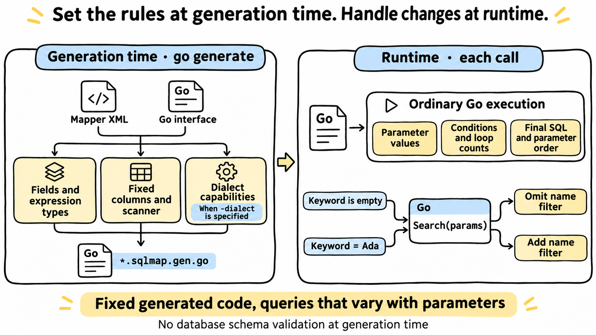

Once the generator has processed the static information, what remains is an ordinary Go builder function. The same function can produce different queries without parsing XML again on each call. With `-dialect`, database capability checks also happen during generation; otherwise, they happen at runtime.

### Pipeline overview

The generator brings XML and Go type information together during semantic analysis, then converts expressions, plans result mappings, and checks dialect capabilities:

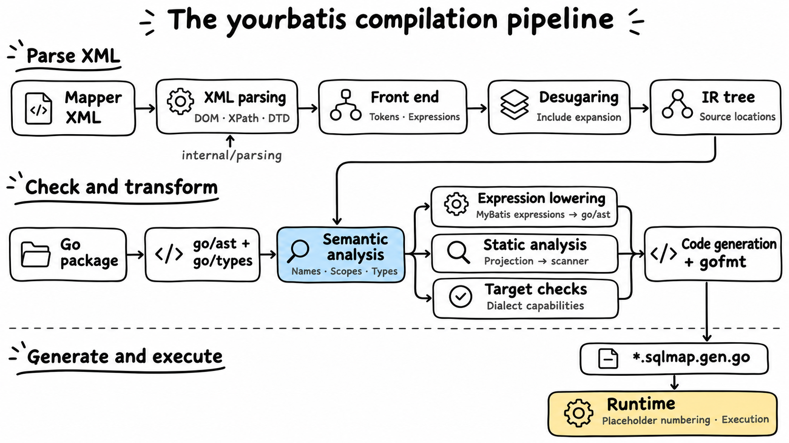

### The front end: three layers of parsing

Mapper XML contains three nested languages: XML structure, `#{}` and `${}` tokens within SQL text, and expressions in attributes such as `test`. The front end parses each layer.

#### Layer 1: XML and a custom DOM

MyBatis relies on the JDK's DOM and XPath support to read XML. Go's `encoding/xml` does not provide those facilities. To preserve MyBatis's rules for whitespace, encodings, and entities, yourbatis ports the parsing layer in `internal/parsing`. A simple query shows how XML becomes a node tree:

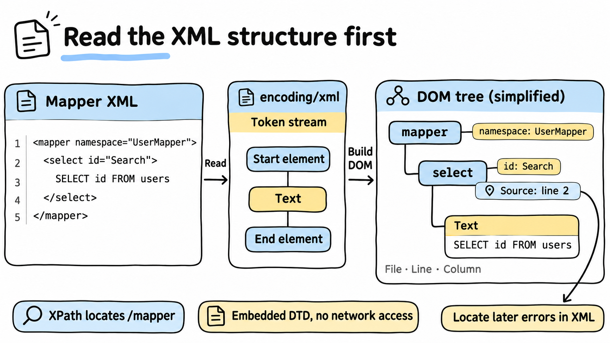

After locating `/mapper` with XPath, the front end walks the DOM to read attributes, text, and child nodes. The embedded DTD keeps generation independent of network access. There is one known limitation: custom entities in SQL text are silently discarded. For example, `FROM &tbl;` becomes `FROM `. Write the text directly instead. Predefined entities such as `&lt;` and `&amp;` are unaffected.

Above this layer, the strict front end in `internal/frontend/xmlmapper` uses an allowlist for elements, attributes, and parameter options. MyBatis is generally more permissive about unknown attributes; yourbatis rejects them:

```text
./user_mapper.xml:23:65: <select> does not support attribute "useCache" in the Go-first XML dialect
```

Silently ignoring `useCache="true"` would leave readers believing caching was enabled. We prefer to fail generation.

#### Layer 2: tokens in SQL text

After reading the SQL text, the front end identifies `#{}` and `${}` and stores plain text, parameter bindings, and text expressions separately:

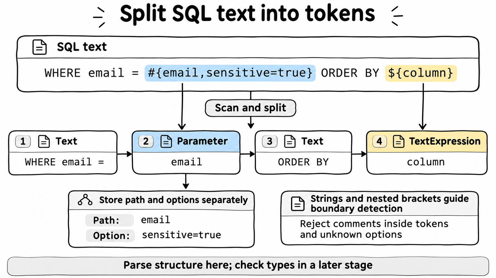

Finding token boundaries requires tracking string literals and nested brackets inside tokens. After splitting, parameter paths and options are stored separately. Comments inside tokens and unknown options are rejected. This stage determines structure; later type checks determine whether expressions are valid.

#### Layer 3: expressions

Expressions in `test`, `value`, and `collection` have two input modes:

- **A native Go subset.** If the expression is valid Go syntax, it is parsed with `go/parser.ParseExpr`, then checked for permitted function calls. This is the recommended form for new Mappers, for example `params.Status != nil && len(params.IDs) > 0`.
- **A MyBatis compatibility subset.** Expressions containing forms such as `and`, `null`, `.size()`, or `in {...}` are handled by a handwritten **recursive descent parser**. It follows operator precedence, with a function for each level: conditional expressions, `or`, `and`, comparisons including `in` and `not in`, addition and subtraction, multiplication and division, unary operators, postfix operations such as field access and indexing, and primary expressions.

Go syntax is the main language. The compatibility subset exists to help migrate MyBatis XML.

### Desugaring and IR

The front end produces a small IR tree in `internal/ir`. MyBatis's many dynamic elements are reduced to nine node types: `Text`, `Parameter` for `#{}`, `TextExpression` for `${}`, `If`, `Choose`, `Foreach`, `Trim`, `Bind`, and `SQLNodeBoundary`.

Desugaring and include expansion account for this reduction:

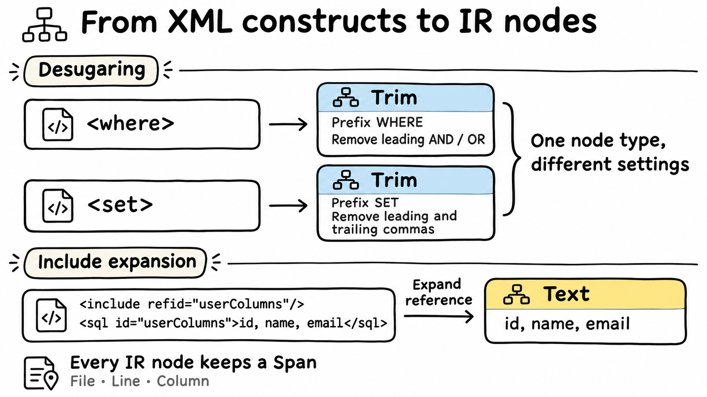

Later stages only need to handle `Trim` and its settings, without treating `<where>` and `<set>` separately. `<include>` has already been replaced by the referenced fragment. The fragment registry rejects duplicate IDs so a later definition cannot overwrite an earlier one.

Each node's `Span` allows errors to point back to XML. XML, expression, and projection errors begin with `file:line:column`. A few interface-to-XML binding errors, such as a namespace mismatch, report only the file path.

`SQLNodeBoundary` is the one node type that does not correspond to an XML element. MyBatis inserts a space on each `appendSql` call when assembling dynamic SQL. yourbatis records those boundaries explicitly in the IR to preserve the same whitespace behavior. SQL text can therefore be compared character by character in migrated test cases.

### Semantic analysis: names, scopes, and types

Valid syntax does not guarantee a meaningful program. Semantic analysis asks what each name refers to, what its type is, and whether the operation is valid.

#### Where names come from

The generator uses `go/parser` to read the target package's source AST and extract Mapper interface signatures, exported struct fields, and `db` or `sqlmap` tags. `golang.org/x/tools/go/packages` is used in two places: resolving actual package names for imports and loading `go/types` information when needed, such as for embedded fields in a resultMap.

Existing `*.sqlmap.gen.go` files are skipped. Generation therefore does not depend on the previous output and can run even if an old generated file is broken.

Expressions can refer to:

- Method parameters, such as `params` and `id`.
- The compatibility alias `_parameter` when there is a single parameter.
- `_databaseId`, supplied by `WithDatabaseID`.
- Variables declared with `<bind>`.
- The `item` and `index` variables of `<foreach>`.

#### Scope chains

Name lookup follows parent pointers from the innermost scope outward. The illustration shows where method parameters, branch-local variables, and loop variables are visible:

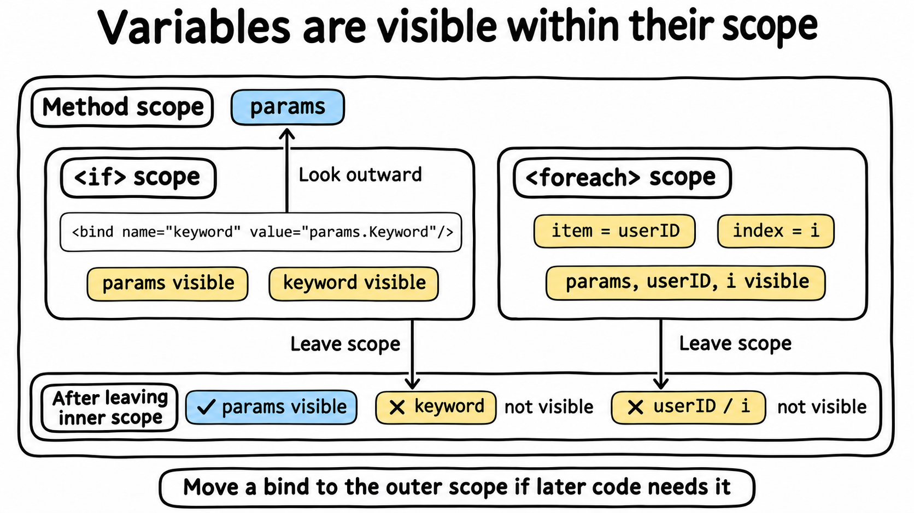

`<when>` and `<otherwise>` also create scopes. `<trim>`, `<where>`, and `<set>` do not. These rules let the generator catch out-of-scope references, such as using `userID` outside its loop:

```text
./user_mapper.xml:77:31: invalid if test "userID > 0": unknown identifier "userID"
```

It also rejects a duplicate declaration in the same scope:

```text
./user_mapper.xml:53:107: bind name "keyword" is already declared in this scope
```

This differs from MyBatis's shared statement context, where a repeated bind overwrites the old value and variables bound inside `<if>` remain visible afterward. When migrating, move a `<bind>` to an outer scope if later code needs it.

#### Type inference and checking

Scopes store types as well as names. In `<bind name="keyword" value="params.Keyword"/>`, `keyword` has no explicit type. The generator infers `string` from the expression on the right and checks later uses accordingly:

```text
./user_mapper.xml:54:43: invalid if test "keyword != nil": type string cannot be compared with nil; use a pointer for nullable values or compare against an explicit value
```

Field access is checked too:

```text
./user_mapper.xml:52:44: invalid if test "params.Keywrd != ''": type SearchUserParams has no exported field "Keywrd"
```

This matters during migration. Java's `String` can be null, so `name != null` is meaningful. In Go, a `string` has the zero value `""`, and `nil` is not a valid value. yourbatis rejects `string != nil`; use `!= ""` for an empty-string check, or a `*string` parameter when absence must be represented.

#### `${}`: types determine what can be emitted

`#{}` passes values to the driver for binding. `${}` changes the SQL text itself. A filter value and a dynamic sort column take different paths:

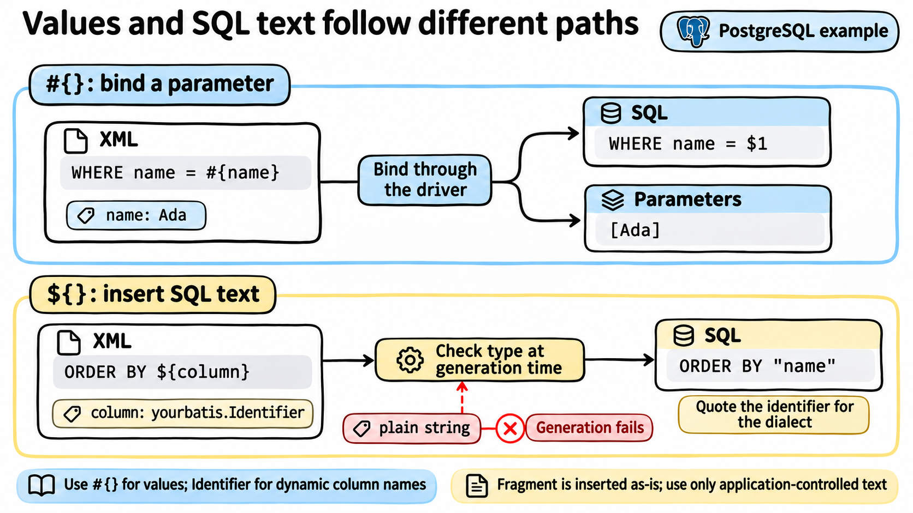

`${}` also accepts numeric values and `bool`, emitted by `AppendSigned`, `AppendUnsigned`, `AppendFloat`, and `AppendBool`. A `Fragment` is inserted as-is and is conventionally created with `TrustedFragment`. Plain `string`, pointers, `any`, and interface types cause generation to fail, for example:

```text
./user_mapper.xml:107:2: unsafe text expression "column": plain string interpolation is disabled; use #{} binding, yourbatis.Identifier, or yourbatis.Fragment
```

The type makes the intent to insert SQL text visible during review. For a dynamic sort column, declare the parameter as `yourbatis.Identifier` and create it with `NewIdentifier`, which validates the identifier's format.

#### Function signatures carry result semantics

Each interface method is linked to an XML statement with the same name, much like matching a declaration to its definition. The generator infers result semantics from the **function signature**:

- `(T, error)` means `one`: exactly one row is required. Zero rows return `sql.ErrNoRows`, one row returns `T`, and multiple rows return `ErrTooManyRows`.
- `(T, bool, error)` means `optional`: zero rows return `zero, false, nil`, one row returns `T, true, nil`, and multiple rows still return `ErrTooManyRows`.
- `([]T, error)` means `many`: return a slice of all results, or an empty slice for zero rows.
- `(..., yield func(T) error) error` means `each`: invoke the callback for each row. With zero rows, no callback is invoked and the method returns `nil`.

For INSERT, UPDATE, and DELETE, returning only `error` implies `exec`, while `(int64, error)` implies `rows`. `returning` and `lastid` must be declared explicitly in XML, for the reasons explained under database capability checks. Invalid signatures fail generation:

```text
./user_mapper.xml:30:53: UserMapper.FindByEmail: optional select methods must return (T, bool, error)
```

Reading the interface tells callers whether a missing row is an error or an expected outcome.

#### The boundary: two layers of type checking

yourbatis checks types in two layers. The generator handles the parts it understands and reports errors against XML locations. The Go compiler checks the generated code during `go build`. The tradeoff is that errors caught by the second layer point to generated files rather than XML. Moving more checks into the first layer is an area for improvement.

### Converting MyBatis conditions to Go

To help with migration, yourbatis supports a subset of MyBatis expression syntax. For example, this checks that a status was provided and the ID list is nonempty:

```xml
<if test="params.Status != null and params.IDs.size() > 0">
```

The generator converts it into an ordinary Go condition:

```go
if params.Status != nil && len(params.IDs) > 0 {
```

`null` becomes `nil`, `and` becomes `&&`, and `.size()` becomes `len()`. Conversion happens during generation; runtime execution uses Go code directly.

Compatibility is limited and does not include full OGNL. New Mappers can use Go conditions directly without this compatibility conversion.

### Static analysis: extracting the SQL projection

The projection is the list of columns a query returns. yourbatis matches column names to Go fields during generation and emits code that scans them in a fixed order. This example uses `db` tags:

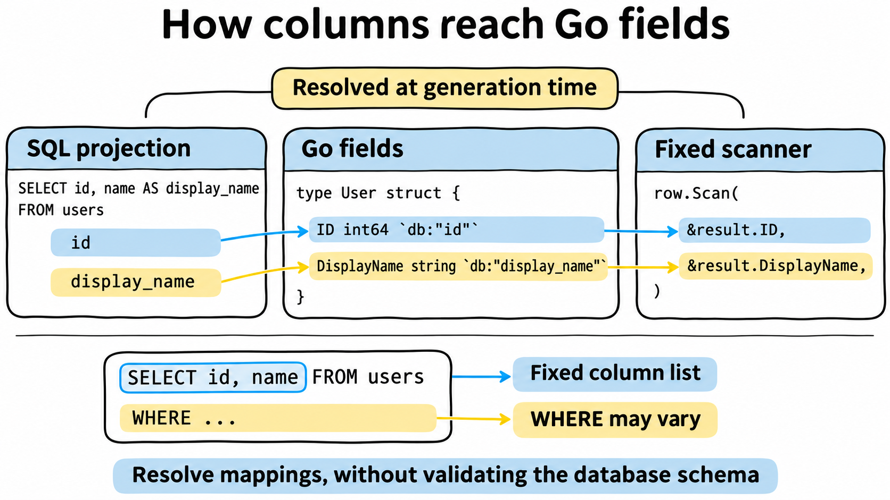

The generator uses a lightweight scanner to extract those columns:

1. Locate the **top-level** `SELECT ... FROM` or `RETURNING` clause, skipping string literals, comments, and subqueries inside parentheses.
2. Split projection items at top-level commas.
3. Require each item to be a simple column reference, such as `name` or `u.name`, or an expression with an explicit `AS` alias. With `result="scalar"`, the single projection item may omit an alias because it is scanned by position.
4. Match columns to struct fields using a `resultMap`, `db` or `sqlmap` tags, or field names.

This step extracts only the information needed for mapping. It does not fully validate SQL syntax or the database schema, avoiding the need for a complete SQL parser for each database.

These rules produce specific error messages:

```text
./user_mapper.xml:23:49: SELECT * cannot be statically mapped; list columns explicitly
```

```text
./user_mapper.xml:38:50: column "user_ident" cannot be mapped to UserLabel; add a db tag, alias, or resultMap
```

```text
./user_mapper.xml:40:31: dynamic <if> cannot change the SELECT projection; generated scanners require a fixed column list
```

The last error explains the boundary shown in the illustration: if the projection changes with parameters, the same fixed scanner cannot be reused, so the generator rejects it.

### Code generation: walking the IR and emitting Go

At this point, names and types have been resolved, and expressions have been converted to Go. The generator emits statements following the nested structure of the IR:

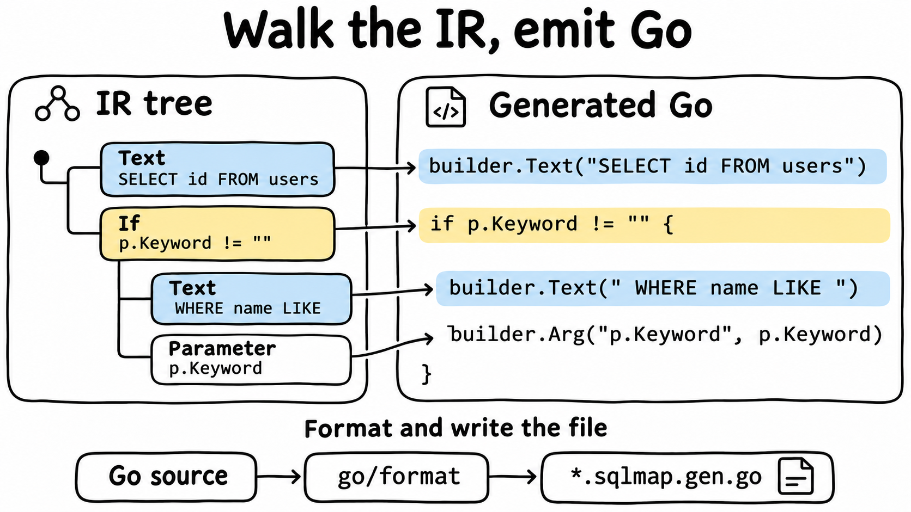

The illustration shows the mapping for text, conditions, and parameters. Other nodes follow the same approach: `Choose` becomes a conditional chain, `Foreach` becomes a loop, `Bind` becomes a local variable, and `Trim` uses a child builder and `AppendTrimmed`.

Here is the XML for the search interface from the opening example:

```xml
<select id="Search" resultType="User">
    SELECT <include refid="userColumns"/>
    FROM users
    <where>
        <if test="params.Keyword != ''">
            <bind name="keyword" value="params.Keyword"/>
            AND name LIKE #{keyword}
        </if>
        <choose>
            <when test="params.Status != nil">
                AND status = #{params.Status}
            </when>
            <otherwise>
                <if test="!params.IncludeDeleted">
                    AND status != 'deleted'
                </if>
            </otherwise>
        </choose>
        <foreach collection="filterPositiveUserIDs(params.IDs)" item="userID"
                 open="AND id IN (" separator="," close=")">
            #{userID}
        </foreach>
    </where>
    ORDER BY created_at DESC
    LIMIT #{params.Limit} OFFSET #{params.Offset}
</select>
```

The following builder function is a **simplified equivalent** for readability. The actual generated code preserves the XML's original whitespace in `Text` calls and includes `BeginSQLNode` markers. The full version is in `example/user/user_mapper.sqlmap.gen.go`.

```go
func buildUserMapperSearch(dialect yourbatis.Dialect, params SearchUserParams) yourbatis.BoundSQL {
    builder := yourbatis.NewBuilder(dialect)
    builder.Text("SELECT id, name, email, status, created_at FROM users")

    trim1 := yourbatis.NewBuilder(dialect)
    if params.Keyword != "" {
        keyword := params.Keyword
        trim1.Text("AND name LIKE ")
        trim1.Arg("keyword", keyword)
    }
    if params.Status != nil {
        trim1.Text("AND status = ")
        trim1.Arg("params.Status", params.Status)
    } else {
        if !params.IncludeDeleted {
            trim1.Text("AND status != 'deleted'")
        }
    }

    foreach2 := yourbatis.NewBuilder(dialect)
    for index, userID := range filterPositiveUserIDs(params.IDs) {
        itemSQL3 := yourbatis.NewBuilder(dialect)
        itemSQL3.Arg("userID", userID)
        foreach2.AppendSeparated(itemSQL3, ",")
    }
    if foreach2.HasIterations() {
        trim1.Text("AND id IN (")
        trim1.Append(foreach2)
        trim1.Text(")")
    }

    builder.AppendTrimmed(trim1, "WHERE ", []string{"AND ", "OR ", /* ... */}, "", nil)
    builder.Text("ORDER BY created_at DESC LIMIT ")
    builder.Arg("params.Limit", params.Limit)
    builder.Text(" OFFSET ")
    builder.Arg("params.Offset", params.Offset)
    return builder.Build()
}
```

`filterPositiveUserIDs` is an ordinary Go function in the same package, so editor navigation, refactoring, and `go vet` work as usual.

The generator numbers internal variable names in sequence, such as `trim1`, `foreach2`, and `itemSQL3`, while avoiding method parameters and names declared by `<bind>` or `<foreach>`. The output is formatted with `go/format`. The same inputs produce byte-for-byte identical output, making generated files straightforward to commit and review.

### Checking database capabilities

Databases support different result modes: `returning` is supported on PostgreSQL and SQLite, while `lastid` is supported on SQLite and MySQL. These modes must be declared explicitly in XML. yourbatis does not switch between them automatically.

With `-dialect`, unsupported modes fail during generation. Without it, checks happen at runtime before SQL execution. For example, PostgreSQL must reject `lastid` before running the INSERT, avoiding an error after data has already been written.

### A thin runtime layer

Generated code depends on an interface with three methods:

```go
type Executor interface {
    Dialect() Dialect
    Query(context.Context, Statement, BoundSQL) (*sql.Rows, error)
    Exec(context.Context, Statement, BoundSQL) (sql.Result, error)
}
```

Both `*yourbatis.DB` and `*yourbatis.Tx` implement it. The rest of the runtime consists of generic helpers such as `SelectOne`, `SelectOptional`, `SelectMany`, `SelectEach`, `ExecuteRows`, and `ExecuteLastInsertID`. They call `database/sql`, run generated scanners, and enforce row-count semantics. Single-row queries attempt one extra read and return `ErrTooManyRows` if a second row exists.

Transaction ownership is explicit. A Mapper executes through the executor it was constructed with:

```go
err := db.Transaction(ctx, func(tx yourbatis.Executor) error {
    users := user.NewUserMapper(tx)
    roles := role.NewRoleMapper(tx)
    if _, err := users.UpdateStatus(ctx, id, user.UserStatusActive); err != nil {
        return err
    }
    return roles.Grant(ctx, id, roleID)
})
```

We do not pass transactions through `context.Context`. Reading whether a Mapper was created with `db` or `tx` tells you which transaction the call belongs to.

Errors are wrapped in `*yourbatis.StatementError`, carrying the statement ID and XML source location while preserving standard checks such as `errors.Is(err, sql.ErrNoRows)`. The logging interface receives the final SQL, parameters, and duration. Parameters marked with `#{email,sensitive=true}` appear as `<redacted>` in debug output.

As for runtime overhead, neither generated code nor the runtime library uses reflection, parses XML, or interprets expressions at runtime.

## Developer experience: navigating between Go and XML

With APIs in Go and SQL in XML, one method spans two files. The IDE's built-in navigation does not take you straight to the SQL: in GoLand, **Go to Implementation** on `UserMapper.Search` opens `user_mapper.sqlmap.gen.go`. That is a valid implementation, but the file a developer wants to edit is usually the XML.

The repository includes a roughly 700-line GoLand/IntelliJ IDEA plugin in `jetbrains-plugin/`. Gutter icons next to an interface or method navigate to the corresponding `<mapper>` or statement. Icons in XML navigate back to Go. The left side below shows the Go-to-XML entry points; the right side shows XML-to-Go. Red arrows point to the plugin's navigation icons.

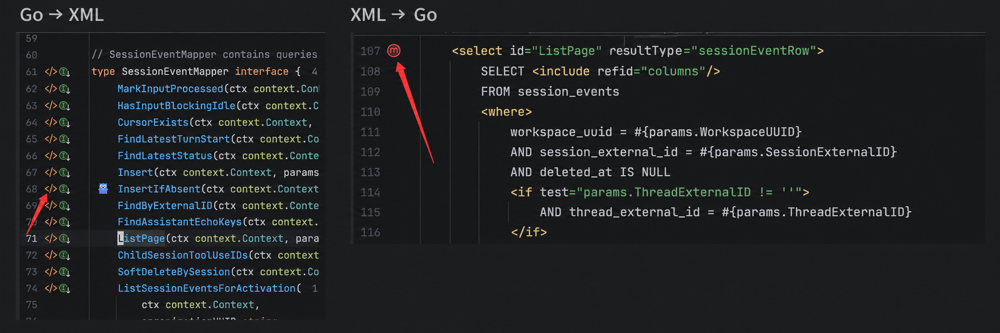

Namespaces can be simple names or qualified names. If multiple targets match, the plugin offers a selection list.

## Closing notes

yourbatis has explicit boundaries. Some features are not yet implemented; others are deliberate design choices.

- **It does not check SQL against the database schema.** sqlc can tell you that `users` has no `emial` column; yourbatis cannot. It checks the contract between SQL and Go, including fields, types, projections, and signatures. Type mismatches with database values can still surface as runtime errors in `rows.Scan`.
- **It is not a complete MyBatis implementation.** It does not support nested object graphs through `association` or `collection`, caching, lazy loading, `selectKey`, `parameterMap`, stored procedures, or cross-file SQL fragments.

The project is open source: [github.com/superduck-ai/yourbatis](https://github.com/superduck-ai/yourbatis). If you find it useful, a GitHub star is welcome.
