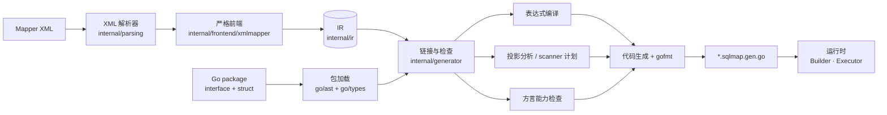

# 在 Go 里写动态 SQL，同时保留编译期的确定性

> yourbatis 是一个实验性的 Go SQL Mapper：你用 Go interface 描述数据访问 API，
> 用 MyBatis 风格的 XML 编写 SQL，再由生成器把两者编译成普通的、可静态检查的
> Go 代码。本文介绍它要解决的问题、现有方案的局限，并重点拆解它的工作原理。

---

## 一个常见的接口

几乎每个后端服务都有这样一个接口：按关键字搜索用户。关键字可能为空，状态筛选是
可选的，调用方可能传入一组 ID，结果还要分页。

```go
type SearchUserParams struct {
    Keyword        string
    Status         *UserStatus
    IDs            []int64
    IncludeDeleted bool
    Limit          int
    Offset         int
}
```

这个需求本身很朴素，但在 Go 里实现它，通常要在下面几条路里选一条，而每条路都要
放弃一些东西：

- **手写 `strings.Builder` 拼接。** SQL 和控制流混在一起；`$1`、`$2` 的编号要手动
  维护；`WHERE` 后面多出的 `AND` 要自己处理。注入风险靠代码审查兜底。
- **改用 query builder。** 拼接问题解决了，但 SQL 变成了一串方法调用。DBA 审查的
  不再是 SQL，而是生成 SQL 的代码。
- **用 sqlc，然后在 SQL 里绕开动态性。** 写成
  `WHERE (sqlc.narg(status)::text IS NULL OR status = sqlc.narg(status))`，或者给每种
  筛选组合各写一条查询。

我们希望有第四条路：**SQL 仍然是 SQL，动态部分有清晰的声明式写法，而所有能在生成期
发现的错误都在生成期发现。** yourbatis 就是对这条路的一次尝试。

## yourbatis 是什么

yourbatis 有两个输入、一个输出：

1. **Go interface**：你亲手定义的 Mapper API。参数、返回类型和结果行数语义都由
   函数签名表达。
2. **Mapper XML**：采用 MyBatis 的 `<if>`、`<where>`、`<foreach>` 等动态 SQL 元素，
   但只接受一个严格、可静态验证的子集。
3. **生成的 Go 代码**：`go generate` 产出一个 `.sqlmap.gen.go` 文件，实现上面的
   interface。

生成之后，程序在运行时**不解析 XML，不解释 OGNL 表达式，也不通过反射扫描结果**。XML
里的 `<if test="params.Keyword != ''">` 会变成生成代码里一行普通的
`if params.Keyword != "" {`。SQL 由类型明确的 Go 代码构建，结果由固定的 `rows.Scan`
调用读取。

```go
//go:generate go run github.com/superduck-ai/yourbatis/cmd/sqlmapgen \
//  -mapper UserMapper -sql ./user_mapper.xml -dialect postgres

type UserMapper interface {
    GetByID(ctx context.Context, id int64) (User, error)
    FindByEmail(ctx context.Context, email string) (User, bool, error)
    Search(ctx context.Context, params SearchUserParams) ([]User, error)
    Create(ctx context.Context, params CreateUserParams) (CreatedUser, error)
}
```

```go
db := yourbatis.NewDB(sqlDB, yourbatis.DialectPostgres)
users := user.NewUserMapper(db)

u, found, err := users.FindByEmail(ctx, "ada@example.com")
```

## 现有方案各自的取舍

Go 社区在数据库访问上已经有很多成熟的选择。在介绍 yourbatis 之前，有必要先说清楚
它们各自擅长什么、在哪里会遇到阻力。

| 方案 | 代表 | SQL 可读性 | 动态 SQL | 错误发现时机 | 隐式行为 |
| --- | --- | --- | --- | --- | --- |
| 标准库 + 轻封装 | `database/sql`、sqlx | 高 | 手写拼接 | 运行时 | 少 |
| Query builder | squirrel、goqu | 中 | 好 | 运行时 | 少 |
| 类型安全 DSL | Jet、bob | 中 | 好 | 编译期（DSL 层面） | 少 |
| ORM | GORM、ent | 低到中 | 好 | 多为运行时 | 多 |
| SQL-first 代码生成 | sqlc | 高 | 弱 | 生成期 | 少 |

sqlc 是这张表里和 yourbatis 理念最接近的项目，下面单独展开。

### sqlc 做对了什么

sqlc 的核心思想很好：**开发者写 SQL，工具生成类型安全的 Go 代码。** 它会读取 schema
和查询，推断参数和结果的类型，把 `SELECT *` 展开成显式列名，并生成直接调用
`database/sql` 的代码。生成的代码没有反射，也没有运行时魔法。它能对照 schema 检查
SQL，这一点 yourbatis 目前做不到（后文会细说）。

### sqlc 的局限

**1. 一个查询对应一条固定的 SQL。** 这是 sqlc 的设计前提，也是它能静态分析每条查询
的原因。代价是动态 SQL 几乎没有原生表达方式。截至本文写作时，sqlc 官方文档列出的
宏只有 `sqlc.arg`、`sqlc.narg`、`sqlc.slice` 和 `sqlc.embed`。社区关于动态查询的长期
讨论（[sqlc-dev/sqlc#364](https://github.com/sqlc-dev/sqlc/discussions/364)）中，维护者
也指出动态查询与"逐条编译查询"的模型存在冲突。实践中常见的绕法有两种：

- 把可选条件写成 `(@x IS NULL OR col = @x)`。SQL 文本不再反映实际意图，而且这类
  "万能条件"可能让优化器难以选择合适的索引。
- 为每种筛选或排序组合各写一条查询，再在 Go 里选择调用哪一条。组合数会随条件数
  指数增长。

动态 `ORDER BY`、部分字段更新（`UPDATE ... SET` 只更新传入的字段）、可变长度的多行
`INSERT`，都会落进同样的困境。

**2. 切片参数依赖数据库。** 在 PostgreSQL 上，`IN` 列表通常写成 `= ANY($1::int[])`；
在 MySQL 和 SQLite 上则使用 `sqlc.slice`。文档注明后者在运行时改写 SQL，因此不能和
prepared statement 一起使用。同一个语义在不同数据库上要用不同写法。

**3. API 的形状由工具推导，而不是由你定义。** 方法签名从 SQL 推导而来：参数多时会
生成 `XxxParams` 结构体，多列结果会生成 `XxxRow` 结构体。`emit_interface` 选项可以
生成一个 `Querier` interface，但它是查询的产物，而不是先于实现存在的契约。

**4. "单行"语义比较宽松。** `:one` 查询使用 `QueryRowContext`。按照 `database/sql`
的语义，零行时返回 `sql.ErrNoRows`，多行时则静默取第一行。如果一条"按邮箱查用户"
的查询因为数据问题返回了两行，调用方不会察觉。

### 其他方案的局限

- **ORM** 的问题在于隐式性：关联预加载、零值处理、钩子和自动迁移带来了便利，但一条
  方法调用究竟执行了几条 SQL，往往要打开日志才知道。
- **Query builder 和类型安全 DSL** 解决了拼接问题，但 SQL 被翻译成了 Go 方法链。对
  需要 DBA 审查 SQL，或者需要直接粘贴到 `psql` 里调试的团队来说，这是一次额外的
  翻译。
- **运行时解析 XML 的 MyBatis 风格方案**保留了 SQL 的可读性和动态能力，但表达式
  在运行时解释，结果映射依赖反射，字段名拼错要到执行那一刻才暴露。

yourbatis 想做的，是把 MyBatis 的动态 SQL 表达力和 sqlc 的生成期确定性结合起来。

## yourbatis 如何工作

`sqlmapgen` 是一个编译器：前端读取 XML 和 Go 源码，中间构造并检查一份中间表示
（IR），后端输出 Go 代码。运行时库只是一层很薄的 `database/sql` 封装。



下面按流水线的顺序逐一拆解。

### 第一步：把 XML 解析成 IR

yourbatis 内置了一个 MyBatis XML 解析器（`internal/parsing`），它对齐了 MyBatis 的
XPath 解析、`#{}`/`${}` 记号解析和 DTD 实体解析行为。现有的 Mapper XML 可以带着
DOCTYPE 直接使用，实体引用和 CDATA 的处理方式也与 MyBatis 一致。

解析结果会交给一个**严格前端**（`internal/frontend/xmlmapper`）。MyBatis 对未知属性
通常比较宽容；yourbatis 则把每个元素、属性和参数选项都当作白名单处理：

```text
./user_mapper.xml:23:65: <select> does not support attribute "useCache" in the Go-first XML dialect
```

这种严格性是刻意的。被静默忽略的 `useCache="true"` 是一种虚假的承诺：读 XML 的人以为
开启了缓存，实际上并没有。我们宁可让生成失败。

前端的产物是一棵很小的 IR 树，节点只有 `Text`、`Parameter`（`#{}`）、
`TextExpression`（`${}`）、`If`、`Choose`、`Foreach`、`Trim`、`Bind` 和
`SQLNodeBoundary` 这几种。`<where>` 和 `<set>` 都被归约成带特定前后缀规则的 `Trim`，
`<include>` 在这一步就地展开。**每个节点都带有 `Span`（文件、行、列）**，所以后续任何
阶段报错都能精确指回 XML 中的位置。本文引用的所有错误信息都以
`./user_mapper.xml:行:列` 开头，原因就在这里。

`SQLNodeBoundary` 值得单独一提。MyBatis 在拼接动态 SQL 时，每次 `appendSql` 之间
会插入一个空格。yourbatis 在 IR 中显式记录这些边界，让生成的 SQL 在空白处理上与
MyBatis 保持一致。这样，从 MyBatis 迁移过来的测试可以直接比较 SQL 文本。

### 第二步：读取 Go 包

生成器使用 `go/parser` 和 `golang.org/x/tools/go/packages` 加载目标包，提取三类信息：

- Mapper interface 中每个方法的参数名、参数类型和返回类型；
- 包内 struct 的导出字段及其 `db`/`sqlmap` tag；
- 用于表达式类型推断的类型信息。

加载时会跳过已有的 `*.sqlmap.gen.go`，所以生成结果永远不依赖上一次生成的产物。即使
生成文件已损坏或已过期，也可以重新生成。

### 第三步：链接方法与 statement，确定结果语义

每个 interface 方法必须在 XML 中有一个同名 statement，namespace 必须与 interface
名称一致。链接时，生成器根据**函数签名**推断结果模式：

| 签名 | 推断模式 | 0 行 | 1 行 | 多行 |
| --- | --- | --- | --- | --- |
| `(T, error)` | one | `sql.ErrNoRows` | `T` | `ErrTooManyRows` |
| `(T, bool, error)` | optional | `zero, false, nil` | `T, true, nil` | `ErrTooManyRows` |
| `([]T, error)` | many | 空 slice | slice | slice |
| `(..., yield func(T) error) error` | each | `nil` | 逐行回调 | 逐行回调 |

INSERT/UPDATE/DELETE 也是类似的：只返回 `error` 时推断为 `exec`，返回
`(int64, error)` 时推断为 `rows`（受影响行数）。`returning` 和 `lastid` 两种模式必须在
XML 中显式写出，原因见下文的方言检查。

这里的设计选择是：**签名就是契约。** 调用方读 interface 就能知道"查不到"是一个错误
还是一个正常分支，不必翻看 XML。签名不合法时，生成直接失败：

```text
./user_mapper.xml:30:53: UserMapper.FindByEmail: optional select methods must return (T, bool, error)
```

### 第四步：把表达式编译成 Go

`<if test>`、`<when test>`、`<bind value>` 和 `<foreach collection>` 里的表达式，是
MyBatis 依赖 OGNL 运行时解释的部分，也是 yourbatis 与运行时方案差异最大的地方。

yourbatis 不实现 OGNL。表达式编译器有两种输入模式：

- **原生 Go 子集**（新 Mapper 推荐）：`params.Status != nil && len(params.IDs) > 0`。
  表达式直接作为 Go 表达式解析，并限制可调用的函数。
- **MyBatis 兼容子集**（迁移用）：识别 `null`、`and`/`or`/`not`、`.size()`、
  `.isEmpty()`、`in`/`not in`、惰性三元表达式等常见写法，先解析成独立的 AST，再
  "降级"为 `go/ast`。例如 MyBatis 测试中的这个条件：

  ```xml
  <if test="value != null and *value not in {''}">
  ```

  会被编译成：

  ```go
  if value != nil && *value != "" {
  ```

无论输入是哪种模式，编译结果都会在一个**作用域**里做名字解析和类型推断。作用域的
来源是方法参数、`<bind>` 声明，以及 `<foreach>` 的 `item`/`index`，嵌套的 `foreach`
会形成嵌套作用域。正因为有类型信息，下面这些错误都会在生成期被发现：

```text
./user_mapper.xml:52:44: invalid if test "params.Keywrd != ''": type SearchUserParams has no exported field "Keywrd"
```

```text
./user_mapper.xml:58:52: invalid when test "params.Keyword != nil": type string cannot be compared with nil; use a pointer for nullable values or compare against an explicit value
```

第二个错误在运行时方案里尤其隐蔽：对一个 `string` 判断 `!= null`，在 OGNL 中永远为
真，条件分支形同虚设。在 yourbatis 里，这直接是一个生成错误，并附带修复建议：用指针
表达"可能为空"。

#### `${}`：用类型系统约束文本插值

`#{}` 总是生成 driver 参数。`${}` 则是把值直接写进 SQL 文本，这是 SQL 注入最常见的
入口。yourbatis 根据表达式的 Go 类型决定 `${}` 可以生成什么：

| 表达式类型 | 生成代码 |
| --- | --- |
| 有符号/无符号整数、浮点数 | `yourbatis.AppendSigned` / `AppendUnsigned` / `AppendFloat` |
| `bool` | `yourbatis.AppendBool` |
| `yourbatis.Identifier` | `yourbatis.AppendIdentifier`（按方言加引号） |
| `yourbatis.Fragment` | 原样写入（必须通过 `TrustedFragment` 显式构造） |
| `string`、指针、`any`、interface | **生成失败** |

```text
./user_mapper.xml:107:2: unsafe text expression "column": plain string interpolation is disabled; use #{} binding, yourbatis.Identifier, or yourbatis.Fragment
```

想要动态排序字段，就把参数声明成 `yourbatis.Identifier`。调用方必须经过
`yourbatis.NewIdentifier` 的校验才能构造它。安全性不再依赖"记得别把用户输入传进
来"，而是由类型签名来保证。

### 第五步：分析投影，生成静态 scanner

运行时方案通常这样映射结果：拿到 `rows.Columns()`，再用反射按列名找字段。yourbatis
在生成期就确定每一列对应哪个字段，并为每个方法生成一个固定的 scanner：

```go
func scanUserMapperGetByID(row yourbatis.Scanner) (User, error) {
    var result User
    err := row.Scan(
        &result.ID,
        &result.Name,
        &result.Email,
        &result.Status,
        &result.CreatedAt,
    )
    return result, err
}
```

要做到这一点，生成器需要从 SQL 文本中可靠地找出投影列：

1. 在 SQL 中定位**顶层**的 `SELECT ... FROM` 或 `RETURNING` 子句，跳过字符串字面量、
   注释和括号内的子查询；
2. 按顶层逗号切分投影项；
3. 每一项必须是简单列引用（`name`、`u.name`）或带显式 `AS` 的表达式；
4. 通过 `resultMap`、`db`/`sqlmap` tag 或字段名，把列名映射到结构体字段。

这套规则带来几个刻意的限制，每个限制都对应一条清晰的错误信息：

```text
./user_mapper.xml:23:49: SELECT * cannot be statically mapped; list columns explicitly
```

```text
./user_mapper.xml:38:50: column "user_ident" cannot be mapped to UserLabel; add a db tag, alias, or resultMap
```

```text
./user_mapper.xml:40:31: dynamic <if> cannot change the SELECT projection; generated scanners require a fixed column list
```

最后一条体现了一个核心取舍：**`WHERE` 可以是动态的，投影必须是静态的。** 投影一旦
随参数变化，scanner 就无法在生成期确定，只能退回运行时反射。我们选择不支持这种写法。

### 第六步：生成 SQL 构建函数

有了编译好的表达式，IR 树可以几乎逐节点地翻译成 Go 代码。以开头的搜索接口为例，
XML 写成：

```xml
<select id="Search" resultType="User">
    SELECT <include refid="userColumns"/>
    FROM users
    <where>
        <if test="params.Keyword != ''">
            <bind name="keyword" value="params.Keyword"/>
            AND name LIKE #{keyword}
        </if>
        <choose>
            <when test="params.Status != nil">
                AND status = #{params.Status}
            </when>
            <otherwise>
                <if test="!params.IncludeDeleted">
                    AND status != 'deleted'
                </if>
            </otherwise>
        </choose>
        <foreach collection="filterPositiveUserIDs(params.IDs)" item="userID"
                 open="AND id IN (" separator="," close=")">
            #{userID}
        </foreach>
    </where>
    ORDER BY created_at DESC
    LIMIT #{params.Limit} OFFSET #{params.Offset}
</select>
```

生成的构建函数如下（节选，省略了纯空白的 `Text` 调用）：

```go
func buildUserMapperSearch(dialect yourbatis.Dialect, params SearchUserParams) yourbatis.BoundSQL {
    builder := yourbatis.NewBuilder(dialect)
    builder.Text("SELECT id, name, email, status, created_at FROM users")

    trim1 := yourbatis.NewBuilder(dialect)
    if params.Keyword != "" {
        keyword := params.Keyword
        trim1.Text("AND name LIKE ")
        trim1.Arg("keyword", keyword)
    }
    if params.Status != nil {
        trim1.Text("AND status = ")
        trim1.Arg("params.Status", params.Status)
    } else {
        if !params.IncludeDeleted {
            trim1.Text("AND status != 'deleted'")
        }
    }

    foreach2 := yourbatis.NewBuilder(dialect)
    for index, userID := range filterPositiveUserIDs(params.IDs) {
        itemSQL3 := yourbatis.NewBuilder(dialect)
        itemSQL3.Arg("userID", userID)
        foreach2.AppendSeparated(itemSQL3, ",")
    }
    if foreach2.HasIterations() {
        trim1.Text("AND id IN (")
        trim1.Append(foreach2)
        trim1.Text(")")
    }

    builder.AppendTrimmed(trim1, "WHERE ", []string{"AND ", "OR ", /* ... */}, "", nil)
    builder.Text("ORDER BY created_at DESC LIMIT ")
    builder.Arg("params.Limit", params.Limit)
    builder.Text(" OFFSET ")
    builder.Arg("params.Offset", params.Offset)
    return builder.Build()
}
```

有几点值得注意：

- `<if>` 变成了 `if`，`<choose>` 变成了 `if/else`，`<bind>` 变成了一个局部变量，
  `<foreach>` 变成了 `for range`。**`foreach` 的 collection 可以直接调用包内的 Go 函数**
  （这里是 `filterPositiveUserIDs`），这些都是普通 Go 代码，编辑器跳转、重构和
  `go vet` 都能正常工作。
- `<where>` 变成了一个子 builder 加上 `AppendTrimmed`：子片段先独立构建，再由运行时
  去掉开头多余的 `AND`/`OR` 并补上 `WHERE `。
- **占位符在 `Build()` 时才编号。** Builder 内部只存储"文本"和"参数"两种 token。如果
  每个子 builder 立即生成 `$1`，嵌套的 `where`/`foreach` 就会各自从 `$1` 开始编号。延迟
  到最后统一渲染，PostgreSQL 的 `$n` 就能正确连续，SQLite 和 MySQL 则统一使用 `?`。

用两组参数调用这个函数，得到的 SQL 如下（空白已整理）：

```sql
-- Keyword="a%", Status=active, IDs=[3, -1, 7], Limit=20
SELECT id, name, email, status, created_at FROM users
WHERE name LIKE $1 AND status = $2 AND id IN ($3, $4)
ORDER BY created_at DESC LIMIT $5 OFFSET $6

-- 全部为空，Limit=20
SELECT id, name, email, status, created_at FROM users
WHERE status != 'deleted'
ORDER BY created_at DESC LIMIT $1 OFFSET $2
```

`-1` 已被 `filterPositiveUserIDs` 过滤掉，第一个条件前的 `AND` 被移除，编号保持连续。
最终，整个生成文件会经过 `go/format` 格式化。同样的输入总是产出同样的输出，生成文件
可以放心提交到版本库并参与代码审查。

### 第七步：方言能力检查

PostgreSQL、SQLite 和 MySQL 获取"刚写入的数据"的方式并不相同：

| | `RETURNING` | `LastInsertId` |
| --- | --- | --- |
| PostgreSQL | 支持 | 不支持 |
| SQLite | 支持 | 支持 |
| MySQL | 不支持 | 支持 |

MyBatis 用 `selectKey` 和 `keyProperty` 抹平这些差异：可能在 INSERT 前后执行一条额外
查询，再用反射把主键写回参数对象。yourbatis 有意不这样做。DML 必须显式声明
`result="returning"`、`"lastid"`、`"rows"` 或 `"exec"`，框架不会在这几种模式之间自动
降级。

能力检查分两个层次：

- **生成期**：传入 `-dialect` 时，不兼容的结果模式会直接导致生成失败。

  ```text
  ./user_mapper.xml:109:41: UserMapper.Create uses result=lastid, but target dialect postgres does not support LastInsertId; use result=returning
  ```

- **运行期**：未传 `-dialect` 时，生成代码会在**执行语句之前**检查当前 executor 的方言。
  `ExecuteLastInsertID` 先检查 `Supports(FeatureLastInsertID)`，通过后才调用
  `ExecContext`。

检查必须放在执行之前，这一点很关键。如果先执行 INSERT，再在 `LastInsertId()` 处报错，
调用方收到的是一个错误，但数据已经写进了数据库。对有副作用的语句来说，"报错"和
"什么都没发生"必须是同一回事。

### 运行时：很薄的一层

生成代码只依赖一个三方法的 interface：

```go
type Executor interface {
    Dialect() Dialect
    Query(context.Context, Statement, BoundSQL) (*sql.Rows, error)
    Exec(context.Context, Statement, BoundSQL) (sql.Result, error)
}
```

`*yourbatis.DB` 和 `*yourbatis.Tx` 都实现了它。运行时库其余部分是一组泛型辅助函数，
如 `SelectOne`、`SelectOptional`、`SelectMany`、`SelectEach`、`ExecuteRows`、
`ExecuteLastInsertID`，负责调用 `database/sql`、执行生成好的 scanner、处理行数语义。
单行查询会尝试读取第二行，以返回 `ErrTooManyRows`，而不是静默丢弃多余的行。

事务没有任何隐式行为。Mapper 绑定在哪个 executor 上，它就在哪个连接上执行：

```go
err := db.Transaction(ctx, func(tx yourbatis.Executor) error {
    users := user.NewUserMapper(tx)
    roles := role.NewRoleMapper(tx)
    if _, err := users.UpdateStatus(ctx, id, user.UserStatusActive); err != nil {
        return err
    }
    return roles.Grant(ctx, id, roleID)
})
```

我们没有通过 `context.Context` 传递事务。读代码的人只要看 Mapper 是用 `db` 还是 `tx`
构造的，就知道这次调用属于哪个事务。

错误会被包装成 `*yourbatis.StatementError`，携带 statement ID 和 XML 来源位置，同时
保留 `errors.Is(err, sql.ErrNoRows)` 这样的标准判断。日志接口能拿到最终 SQL、参数和
耗时；标记为 `#{email,sensitive=true}` 的参数在调试输出中显示为 `<redacted>`。

### 生成期能发现的错误

把前面的例子汇总一下。下面的错误在 yourbatis 中都发生在 `go generate` 阶段，而在
运行时解析 XML 的方案中，它们通常要到对应代码路径真正执行时才会暴露：

| 错误 | 生成期信息（节选） |
| --- | --- |
| 表达式引用了不存在的字段 | `type SearchUserParams has no exported field "Keywrd"` |
| 对非指针类型判断 nil | `type string cannot be compared with nil` |
| `${}` 传入普通字符串 | `plain string interpolation is disabled` |
| `SELECT *` | `SELECT * cannot be statically mapped` |
| 列无法映射到字段 | `column "user_ident" cannot be mapped to UserLabel` |
| 动态节点改变投影 | `dynamic <if> cannot change the SELECT projection` |
| 签名与结果模式不符 | `optional select methods must return (T, bool, error)` |
| 方言不支持的结果模式 | `target dialect postgres does not support LastInsertId` |
| 未知 XML 属性 | `<select> does not support attribute "useCache"` |

## 我们如何验证它

一个声称"兼容 MyBatis 动态 SQL 子集"的工具，最容易犯的错误是自己定义了"兼容"的含义。
为此，我们把 MyBatis 自身的测试作为行为依据，逐项迁移成 yourbatis 的一致性测试，并
维护可追溯的迁移矩阵：43 项核心测试、28 项动态表达式扩展，以及 62 个 XML 用例清单。
每一项都会标注迁移状态，或者明确说明为什么不支持。

所有一致性测试都会走完整的流水线：XML fixture、`go generate`、断言生成代码，然后在真实
数据库上执行生成的 Mapper。SQLite（`modernc.org/sqlite`）和 PostgreSQL 是一级支持
目标，新功能必须在两者上都有集成测试才算完成。只在 SQLite 上通过、或者只编译而跳过
的 PostgreSQL 测试，不算完成。当两种数据库能力不同时（比如 `lastid`），我们会为支持的
一方写正向测试，为不支持的一方写拒绝测试。

## 它不是什么

yourbatis 有明确的边界。有些是"暂未实现"，更多是刻意的设计选择。

- **它不检查 SQL 是否符合数据库 schema。** sqlc 能告诉你 `users` 表没有 `emial` 列，
  yourbatis 不能。它检查的是 SQL 和 Go 之间的契约（字段、类型、投影和签名），而不是
  SQL 和数据库之间的契约。类型不匹配会在 `rows.Scan` 时以运行时错误的形式出现。
  这是本文所述方案里最大的取舍。
- **它不是完整的 MyBatis。** 不支持 `association`/`collection` 等嵌套对象图、OGNL、
  缓存、懒加载、`selectKey`、`parameterMap`、存储过程，也不支持跨文件的 SQL 片段。
- **它不追求数据库可移植性。** 只支持 PostgreSQL、SQLite（一级）和 MySQL（二级）。
  MariaDB 不会被自动当作 MySQL 处理，因为两者的 DML 返回能力不同。
- **它仍处于实验阶段。** API 和 XML 方言都可能调整。

## 什么时候该选哪个

- 如果你的查询大多是静态的，并且希望 SQL 对照 schema 做检查，**sqlc 是很好的选择**。
- 如果你需要频繁组合可选条件、动态排序或批量写入，又不想把 SQL 改写成方法链，
  **可以试试 yourbatis**。
- 如果你的团队正在把 Java/MyBatis 的经验或 Mapper XML 迁移到 Go，yourbatis 的兼容
  表达式子集和迁移测试矩阵可以降低迁移成本。
- 两者并不互斥：同一个服务里，可以用 sqlc 处理静态查询，用 yourbatis 处理动态查询。

## 开始使用

仓库里有一个完整的 SQLite 示例：

```bash
go generate ./example/user
go test ./example/user
```

生成结果可以在 `example/user/user_mapper.sqlmap.gen.go` 中直接阅读。我们建议从这个
文件开始了解 yourbatis：它就是普通的 Go 代码。GoLand/IntelliJ 用户还可以安装仓库里
的 `jetbrains-plugin`，在 Go 方法与 XML statement 之间双向跳转。

更多细节请参阅：

- [README](../../README.md)：完整的使用说明
- [DML 返回值支持](../dml-result-support.md)
- [MyBatis 动态 SQL 迁移计划](../mybatis-dynamic-sql-plan.md)
- [Java 动态 SQL 测试迁移状态](../mybatis-java-test-migration.md)

我们很想听到你的反馈，特别是那些"在 sqlc 里写不出来"的真实查询。它们是决定 yourbatis
下一步该支持什么、不该支持什么的最好依据。
