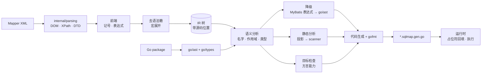

# 在 Go 里写动态 SQL，同时保留编译期的确定性

yourbatis 是一个开源的 Go SQL Mapper。你用 Go interface 定义数据访问 API，用 MyBatis
风格的 XML 编写 SQL，然后由 `go generate` 把两者编译成普通的 Go 代码。生成后的程序在
运行时不解析 XML，不解释表达式，也不依赖反射。

我们做这个项目，是因为 Go 生态里缺少这样一种工具：既能像 MyBatis 那样用 `<if>`、
`<where>`、`<foreach>` 写动态 SQL，又能像 sqlc 那样在生成期就发现错误。

本文会介绍 yourbatis 是什么、它解决了什么问题，以及 sqlc 等现有方案的局限，并重点拆解
它的工作原理。项目目前仍处于实验阶段，代码在
[github.com/superduck-ai/yourbatis](https://github.com/superduck-ai/yourbatis)。

## 设计来源：MyBatis

yourbatis 的 XML 写法来自 MyBatis（前身是 2001 年前后诞生的 iBATIS）。与 ORM 不同，MyBatis
不替开发者生成 SQL，只负责把手写 SQL 的输入和输出映射到对象上，至今仍是 Java 生态最常用的
数据访问方式之一。它的不足在于动态 SQL 依赖 OGNL 在运行时解释表达式，结果映射依赖反射，
错误要到执行时才会暴露。

yourbatis 保留 MyBatis 的 SQL 和动态写法，把这些检查都提前到生成期完成。

## 一个看似简单的搜索接口

问题往往始于一个普通的需求：按条件搜索用户。

```go
type SearchUserParams struct {
    Keyword        string      // 为空表示不按名字筛选
    Status         *UserStatus // nil 表示不按状态筛选
    IDs            []int64     // 为空表示不限定 ID
    IncludeDeleted bool
    Limit          int
    Offset         int
}
```

每个筛选条件都是可选的，所以同一个方法在不同调用下要发出不同的 SQL：

```sql
-- 只传分页参数（默认排除已删除用户）
SELECT id, name, email, status, created_at FROM users
WHERE status != 'deleted'
ORDER BY created_at DESC LIMIT $1 OFFSET $2

-- 传入关键字、状态和两个 ID
SELECT id, name, email, status, created_at FROM users
WHERE name LIKE $1 AND status = $2 AND id IN ($3, $4)
ORDER BY created_at DESC LIMIT $5 OFFSET $6
```

条件个数、占位符编号、`WHERE` 后面的第一个 `AND`、`IN` 列表的长度，都会随参数变化。
这些细节并不难，但每一个都可能出错，而且通常要到某个特定的参数组合真正执行时才会
暴露出来。

在 Go 里实现它，常见的三种做法各有代价：

- **手写拼接。** SQL 依然可读，也足够灵活，但 `$n` 编号、多余的 `AND` 和注入防护都
  靠人来保证。错误只能在运行时发现。
- **改用 query builder 或 ORM。** 拼接问题交给了库，但 SQL 变成了方法调用。代码审查
  时看到的不再是将要执行的 SQL，而是生成 SQL 的 Go 代码。
- **用 sqlc。** SQL 可读，并且能在生成期检查，但每个查询只能对应一条固定的 SQL。
  可选条件只能写成 `(sqlc.narg(status) IS NULL OR status = sqlc.narg(status))` 这样的
  形式，或者给每种组合各写一条查询。

换句话说，**SQL 可读、能表达动态逻辑、错误在执行前暴露**，这三点在现有工具里很难同时
做到。yourbatis 的目标是三者兼顾：SQL 仍然是 SQL，动态部分用声明式元素表达，表达式、
字段和类型错误在 `go generate` 阶段就报出来。为此它也接受了另一些约束，比如投影必须
是静态的，也不对照数据库 schema 做检查。后文会如实说明这些约束。

## yourbatis 是什么

yourbatis 有两个输入、一个输出：

1. **Go interface**：你亲手定义的 Mapper API。参数、返回类型和结果行数语义都由
   函数签名表达。
2. **Mapper XML**：采用 MyBatis 的 `<if>`、`<where>`、`<foreach>` 等动态 SQL 元素，
   但只接受一个严格、可静态验证的子集。
3. **生成的 Go 代码**：`go generate` 产出一个 `.sqlmap.gen.go` 文件，实现上面的
   interface。

生成之后，程序在运行时**不解析 XML，不解释 OGNL 表达式，也不通过反射扫描结果**。XML
里的 `<if test="params.Keyword != ''">` 会变成生成代码里一行普通的
`if params.Keyword != "" {`。SQL 由类型明确的 Go 代码构建，结果由固定的 `rows.Scan`
调用读取。

```go
//go:generate go run github.com/superduck-ai/yourbatis/cmd/sqlmapgen \
//  -mapper UserMapper -sql ./user_mapper.xml -dialect postgres

type UserMapper interface {
    GetByID(ctx context.Context, id int64) (User, error)
    FindByEmail(ctx context.Context, email string) (User, bool, error)
    Search(ctx context.Context, params SearchUserParams) ([]User, error)
    Create(ctx context.Context, params CreateUserParams) (CreatedUser, error)
}
```

```go
db := yourbatis.NewDB(sqlDB, yourbatis.DialectPostgres)
users := user.NewUserMapper(db)

u, found, err := users.FindByEmail(ctx, "ada@example.com")
```

## 现有方案各自的取舍

Go 社区在数据库访问上已经有很多成熟的选择。在介绍 yourbatis 之前，有必要先说清楚
它们各自擅长什么、在哪里会遇到阻力。

| 方案 | 代表 | SQL 可读性 | 动态 SQL | 错误发现时机 | 隐式行为 |
| --- | --- | --- | --- | --- | --- |
| 标准库 + 轻封装 | `database/sql`、sqlx | 高 | 手写拼接 | 运行时 | 少 |
| Query builder | squirrel、goqu | 中 | 好 | 运行时 | 少 |
| 类型安全 DSL | Jet、bob | 中 | 好 | 编译期（DSL 层面） | 少 |
| ORM | GORM、ent | 低到中 | 好 | 多为运行时 | 多 |
| SQL-first 代码生成 | sqlc | 高 | 弱 | 生成期 | 少 |

sqlc 是这张表里和 yourbatis 理念最接近的项目，下面单独展开。

### sqlc 做对了什么

sqlc 的核心思想很好：**开发者写 SQL，工具生成类型安全的 Go 代码。** 它会读取 schema
和查询，推断参数和结果的类型，把 `SELECT *` 展开成显式列名，并生成直接调用
`database/sql` 的代码。生成的代码没有反射，也没有运行时魔法。它能对照 schema 检查
SQL，这一点 yourbatis 目前做不到（后文会细说）。

### sqlc 的局限

**1. 一个查询对应一条固定的 SQL。** 这是 sqlc 的设计前提，也是它能静态分析每条查询
的原因。代价是动态 SQL 几乎没有原生表达方式。截至本文写作时，sqlc 官方文档列出的
宏只有 `sqlc.arg`、`sqlc.narg`、`sqlc.slice` 和 `sqlc.embed`。社区关于动态查询的长期
讨论（[sqlc-dev/sqlc#364](https://github.com/sqlc-dev/sqlc/discussions/364)）中，维护者
也指出动态查询与"逐条编译查询"的模型存在冲突。实践中常见的绕法有两种：

- 把可选条件写成 `(@x IS NULL OR col = @x)`。SQL 文本不再反映实际意图，而且这类
  "万能条件"可能让优化器难以选择合适的索引。
- 为每种筛选或排序组合各写一条查询，再在 Go 里选择调用哪一条。组合数会随条件数
  指数增长。

动态 `ORDER BY`、部分字段更新（`UPDATE ... SET` 只更新传入的字段）、可变长度的多行
`INSERT`，都会落进同样的困境。

**2. 切片参数依赖数据库。** 在 PostgreSQL 上，`IN` 列表通常写成 `= ANY($1::int[])`；
在 MySQL 和 SQLite 上则使用 `sqlc.slice`。文档注明后者在运行时改写 SQL，因此不能和
prepared statement 一起使用。同一个语义在不同数据库上要用不同写法。

**3. API 的形状由工具推导，而不是由你定义。** 方法签名从 SQL 推导而来：参数多时会
生成 `XxxParams` 结构体，多列结果会生成 `XxxRow` 结构体。`emit_interface` 选项可以
生成一个 `Querier` interface，但它是查询的产物，而不是先于实现存在的契约。

**4. "单行"语义比较宽松。** `:one` 查询使用 `QueryRowContext`。按照 `database/sql`
的语义，零行时返回 `sql.ErrNoRows`，多行时则静默取第一行。如果一条"按邮箱查用户"
的查询因为数据问题返回了两行，调用方不会察觉。

### 其他方案的局限

- **ORM** 的问题在于隐式性：关联预加载、零值处理、钩子和自动迁移带来了便利，但一条
  方法调用究竟执行了几条 SQL，往往要打开日志才知道。
- **Query builder 和类型安全 DSL** 解决了拼接问题，但 SQL 被翻译成了 Go 方法链。对
  需要 DBA 审查 SQL，或者需要直接粘贴到 `psql` 里调试的团队来说，这是一次额外的
  翻译。
- **运行时解析 XML 的 MyBatis 风格方案**保留了 SQL 的可读性和动态能力，但表达式
  在运行时解释，结果映射依赖反射，字段名拼错要到执行那一刻才暴露。

yourbatis 想做的，是把 MyBatis 的动态 SQL 表达力和 sqlc 的生成期确定性结合起来。

## yourbatis 如何工作

先换个角度看 Mapper XML：它其实是一段**程序**。输入是方法参数，输出是一条 SQL 加一组参数
值。`<if>` 是条件分支，`<foreach>` 是循环，`<bind>` 是变量声明，`test` 属性里写的是表达式。

MyBatis 用**解释器**运行这段程序：每次调用 Mapper 方法，它都要遍历一遍 XML 节点树，用 OGNL
求值表达式，用反射读取参数字段，再用反射把结果写回对象。yourbatis 走的是另一条路：它是一个
**编译器**，在 `go generate` 时把这段程序翻译成 Go，运行时只执行翻译后的结果。

解释器和编译器之间最大的差别，在于错误何时暴露。解释器只能在执行到某条路径时发现那条路径上的
问题，编译器则可以在执行之前检查整段程序。本节按编译器的结构来拆解 `sqlmapgen`。它是一个小
编译器：没有优化 pass，IR 是一棵树而不是 SSA，类型信息有一部分直接借助 `go/types` 获得。但
前端、语义分析、降级、代码生成这些环节都齐全，而且每一环都对应着一类可以提前发现的错误。

### 两个阶段：哪些事在生成期确定

理解 yourbatis 的设计，关键是一个编译原理里的概念：**分阶段**（staging，也称绑定时间分析）。
程序里的每一个量，要么在生成期就能确定，要么必须等到运行期才知道：

| 生成期确定（静态） | 运行期确定（动态） |
| --- | --- |
| SQL 的结构和文本片段 | 参数的具体值 |
| 每个表达式的类型 | `<if>` 条件的真假 |
| 名字解析到哪个参数或字段 | `<foreach>` 循环的次数 |
| 投影列以及列到字段的映射（即 scanner） | 最终 SQL 中占位符的个数和编号 |
| 目标方言是否支持某种结果模式 | |

yourbatis 在生成期把左列全部算完，剩下的右列就是生成出来的 SQL 构建函数。用部分求值
（partial evaluation）的术语来说，构建函数是 XML 程序针对静态信息特化之后的**剩余程序**
（residual program）。

后文的许多限制，都可以用这张表推导出来：

- 投影必须是静态的，因为 scanner 在左列：它在生成期就要确定每一列写进哪个字段。
- `${}` 只接受特定类型，因为"这段文本会被如何拼进 SQL"需要在生成期确定，而它取决于表达式的
  类型。
- 不支持完整的 OGNL，因为 OGNL 的很多语义依赖运行时类型，没法挪到左列。

### 流水线总览



各阶段与 yourbatis 实现的对应关系：

| 编译器阶段 | yourbatis 中的实现 |
| --- | --- |
| 词法与语法分析 | 自建 DOM 与 XPath 子集（`internal/parsing`），加上 `#{}`/`${}` 记号和表达式解析 |
| 去语法糖与宏展开 | `<where>`/`<set>` 归约为 `Trim`，`<include>` 就地展开 |
| 中间表示 | 9 种 IR 节点，每个节点带源码位置 `Span` |
| 语义分析 | 作用域链、名字解析、类型推断、签名检查 |
| 降级 | MyBatis 兼容表达式转换为 `go/ast` |
| 静态分析 | 从 SQL 文本中提取投影列，生成 scanner 计划 |
| 目标检查 | `-dialect` 决定可用的结果模式 |
| 代码生成 | 遍历 IR 输出 Go 源码，经 `go/format` 格式化 |
| 回填 | 运行时在 `Build()` 中统一为占位符编号 |

下面逐个展开。

### 前端：三层解析

一份 Mapper XML 里嵌套着三种语言，前端要分三层解析：XML 结构、SQL 文本里的 `#{}`/`${}` 记号，
以及 `test` 等属性里的表达式。

#### 第一层：XML，以及一个自建的 DOM

这一层看起来最普通，实际工作量却最大。

MyBatis 读取 XML 依靠的是 JDK：先用 DOM 解析器构建节点树，再用 `javax.xml.xpath` 查询节点。
所以 MyBatis 对一份 XML 的很多"读法"，其实是 JDK 的行为，包括：
- 空白怎么裁剪；
- 实体怎么展开；
- CDATA 和普通文本是否区分；
- `DOCTYPE` 指向的 DTD 从哪里加载；
- 文件编码怎么识别。

Go 标准库的 `encoding/xml` 只提供流式的 token 解码器和基于反射的 `Unmarshal`：没有 DOM，没有
XPath，也不加载外部 DTD。要让同一份 Mapper XML 在 yourbatis 和 MyBatis 中读出相同的结果，就
必须把这一层补齐。

因此，`internal/parsing` 是 MyBatis `org.apache.ibatis.parsing` 包的 Go 移植，同时补上了它所依赖
的那部分 JDK 能力：

- **自建 DOM（`node.go`，约 1200 行）。** 在 `encoding/xml` 的 token 流之上构建节点树，区分
  元素、属性、文本、CDATA 和实体引用节点，并维护文档顺序。它为每个节点记录行、列和字节偏移，
  这正是后文 IR 中 `Span` 的来源，也是所有错误信息能精确到 `行:列` 的原因。它还提供 DOM 风格的
  克隆、导入、插入和替换接口。
- **编码识别。** 按照 XML 规范检测 BOM、UTF-16/UTF-32 的字节序和 EBCDIC，再结合
  `<?xml encoding="..."?>` 声明，通过 `golang.org/x/text` 解码。测试覆盖了 Shift_JIS、GBK 等
  编码，以及声明与实际编码冲突、字节序列非法等异常情况。
- **DTD 与实体。** `<!DOCTYPE mapper PUBLIC "-//mybatis.org//DTD Mapper 3.0//EN" ...>` 会被
  解析。`mybatis-3-mapper.dtd` 直接内嵌在二进制中，同时兼容旧的 `ibatis-3` 名称，所以生成时
  **不会访问网络**。DTD 中声明的实体会在属性值和文本中展开。
- **XPath 子集（`xpath_parser.go`，约 2600 行）。** 支持位置路径、谓词（位置判断和属性比较）、
  并集、比较、逻辑和算术运算，以及 string/number/boolean 之间的类型转换。对外提供与 MyBatis
  `XPathParser` 同名的 `EvalString`、`EvalBoolean`、`EvalNodes` 等方法。
- **`XNode`、`GenericTokenParser`、`PropertyParser`。** 它们与 MyBatis 中的同名类一一对应。
  `<include>` 内 `<property>` 的 `${}` 替换就由它们完成。连空白裁剪都复刻了 Java 的
  `String.trim()`：它删除所有码点不超过 U+0020 的字符，与 Go 的 `strings.TrimSpace`（按 Unicode
  空白判断）结果并不相同。

"与 MyBatis 一致"需要能够验证。这个包有 110 个测试，部分 fixture 直接取自 MyBatis 的测试资源
（`nodelet_test.xml`）。很多测试名本身就是断言，例如
`TestXPathParserShouldMatchJavaReaderAndInputStreamEncodingSemantics`、
`TestXPathParserShouldTreatNumericPredicateExpressionsAsPositionTestsLikeJDKXPath`、
`TestGenericTokenParserShouldParseLargeInputsLikeMyBatisIssue760`。

需要如实说明的是：目前生成器只用到了这一层的一小部分。前端调用 XPath 只做一件事，就是定位
`/mapper` 根节点；之后都是沿着 DOM 遍历子节点，读取属性、文本和源码位置。完整的 XPath 子集和
DOM 修改接口，是为了与 MyBatis 的 `parsing` 包在 API 和行为上保持一致而移植的，目前主要由这一层
自己的测试使用。我们选择把它作为一个独立的、测试完整的基础层保留下来，而不是只裁出生成器眼下
需要的部分。这样，"XML 应该怎么读"始终有一个明确的参照物，即 MyBatis 加 JDK。前端以后需要
更多能力时，也不必重新推敲这些边界行为。

在这一层之上，严格前端（`internal/frontend/xmlmapper`）把每个元素、属性和参数选项都当作白名单
处理。MyBatis 对未知属性通常比较宽容，yourbatis 则直接拒绝：

```text
./user_mapper.xml:23:65: <select> does not support attribute "useCache" in the Go-first XML dialect
```

被静默忽略的 `useCache="true"` 是一种虚假的承诺：读 XML 的人以为开启了缓存，实际上并没有。
我们宁愿让生成失败。

#### 第二层：SQL 文本中的记号

前端用一个专门的扫描器在文本里查找 `#{` 和 `${`。扫描时会跟踪字符串字面量和嵌套括号，确保
`#{user.Name}` 的结束位置判断正确。然后切分出参数路径和选项，例如 `#{email,sensitive=true}`。
记号内部不允许出现注释，未知的参数选项同样会被拒绝。

#### 第三层：表达式

`test`、`value`、`collection` 属性里的表达式有两种输入模式：

- **原生 Go 子集。** 如果表达式本身就是合法的 Go 表达式，就直接交给 `go/parser.ParseExpr`
  解析，再检查其中的函数调用是否在允许的范围内。新 Mapper 推荐使用这种写法，例如
  `params.Status != nil && len(params.IDs) > 0`。
- **MyBatis 兼容子集。** 当表达式中出现 `and`、`null`、`.size()`、`in {...}` 这类 MyBatis
  写法时，交给一个手写的**递归下降解析器**。它按运算符优先级逐层解析，每一层对应一个函数：
  三元表达式 → `or` → `and` → 比较（含 `in`/`not in`）→ 加减 → 乘除 → 一元运算 → 后缀（字段
  访问、方法调用、下标）→ 基本项。

两种模式分工明确：Go 写法是主要语言，兼容子集只为迁移已有的 MyBatis XML 而存在。

### 去语法糖与 IR

前端的输出是一棵很小的 IR 树（`internal/ir`）。MyBatis 的十几种动态元素，最后只剩 9 种节点：
`Text`、`Parameter`（`#{}`）、`TextExpression`（`${}`）、`If`、`Choose`、`Foreach`、`Trim`、
`Bind` 和 `SQLNodeBoundary`。

元素变少是因为前端做了两件事。

**去语法糖。** `<where>` 和 `<set>` 并不是独立的概念，它们只是带特定参数的 `<trim>`：

| 元素 | 等价的 `Trim` |
| --- | --- |
| `<where>` | prefix `WHERE `，去掉开头的 `AND `/`OR ` |
| `<set>` | prefix `SET `，去掉开头和结尾多余的 `,` |

归约之后，后续阶段只需要处理一种节点。

**宏展开。** `<include refid="userColumns"/>` 在前端就被替换成对应 `<sql>` 片段的内容，类似于
C 预处理器展开宏。片段注册表用一个"只允许插入一次"的 map 实现，重复定义同一个 `id` 会直接
报错，而不是让后一个定义覆盖前一个。

IR 的每个节点都带有 `Span`，记录文件、行和列。这相当于编译器里的源码位置信息：后面任何阶段
报错，都能精确指回 XML 中的某一行某一列。本文引用的所有错误信息都以 `./user_mapper.xml:行:列`
开头，原因就在这里。

`SQLNodeBoundary` 是唯一一个不对应 XML 元素的节点。MyBatis 在拼接动态 SQL 时，每次调用
`appendSql` 都会插入一个空格。yourbatis 在 IR 里显式记录这些边界，让生成的 SQL 在空白处理上与
MyBatis 完全一致。这样，从 MyBatis 迁移过来的测试可以直接逐字比较 SQL 文本。

### 语义分析：名字、作用域与类型

语法正确不代表程序有意义。语义分析要回答三个问题：每个名字指向什么？它的类型是什么？这样
使用是否合法？

#### 符号从哪里来

生成器用 `go/parser` 和 `golang.org/x/tools/go/packages` 加载目标包，读取 Mapper interface 的
方法签名、struct 的导出字段及 `db` tag，以及 `go/types` 提供的类型信息。加载时会跳过已有的
`*.sqlmap.gen.go`，所以生成结果不依赖上一次的产物，即使旧的生成文件已经损坏也能重新生成。

表达式里可以引用的名字有这几类：

- 方法参数（例如 `params`、`id`）；
- 只有一个参数时的兼容别名 `_parameter`；
- 来自 `WithDatabaseID` 的 `_databaseId`；
- `<bind>` 声明的变量；
- `<foreach>` 的 `item` 和 `index`。

#### 作用域链

作用域的实现和大多数语言的编译器一样，是一条带父指针的链：方法参数位于最外层，每个
`<foreach>` 会打开一层新的作用域，在里面声明 `item` 和 `index`。查找名字时沿着链从内向外找。

这让两类错误可以在生成期发现。第一类是在循环外引用循环变量：

```text
./user_mapper.xml:77:31: invalid if test "userID > 0": unknown identifier "userID"
```

第二类是在同一作用域里重复声明：

```text
./user_mapper.xml:53:107: bind name "keyword" is already declared in this scope
```

在 MyBatis 里，这两种情况都要等到运行时才会显现：前者在表达式求值时读到一个不存在的变量，
后者是后一次 `bind` 静默覆盖前一次。

#### 类型推断与类型检查

作用域里存放的不只是名字，还有类型。`<bind name="keyword" value="params.Keyword"/>` 中的
`keyword` 没有显式写出类型，生成器从右侧表达式推断出它是 `string`。后续对 `keyword` 的每一次
使用，都会按 `string` 来检查：

```text
./user_mapper.xml:54:43: invalid if test "keyword != nil": type string cannot be compared with nil; use a pointer for nullable values or compare against an explicit value
```

字段访问同样会经过检查：

```text
./user_mapper.xml:52:44: invalid if test "params.Keywrd != ''": type SearchUserParams has no exported field "Keywrd"
```

`!= nil` 这条检查在实践中特别有用。在 OGNL 里，对一个 `String` 判断 `!= null` 几乎总是为真，
条件分支形同虚设。在 Go 里，"可能不存在"需要用指针或其他可为 nil 的类型来表达，生成器把这条
规则搬到了 XML 里。

#### `${}`：由类型决定能生成什么

`#{}` 总是生成驱动参数。`${}` 则是把值直接写进 SQL 文本，这是 SQL 注入最常见的入口。语义分析
根据表达式的类型，决定 `${}` 可以生成什么代码：

| 表达式类型 | 生成代码 |
| --- | --- |
| 有符号/无符号整数、浮点数 | `yourbatis.AppendSigned` / `AppendUnsigned` / `AppendFloat` |
| `bool` | `yourbatis.AppendBool` |
| `yourbatis.Identifier` | `yourbatis.AppendIdentifier`（按方言加引号） |
| `yourbatis.Fragment` | 原样写入（必须通过 `TrustedFragment` 显式构造） |
| `string`、指针、`any`、interface | **生成失败** |

```text
./user_mapper.xml:107:2: unsafe text expression "column": plain string interpolation is disabled; use #{} binding, yourbatis.Identifier, or yourbatis.Fragment
```

这是类型系统的典型用法：用类型来区分"可信"和"不可信"的值。要动态指定排序字段，就把参数声明
为 `yourbatis.Identifier`，调用方必须经过 `NewIdentifier` 的校验才能构造它。安全性因此不再依赖
"记得别把用户输入传进来"，而是由函数签名保证。

#### 函数签名也是类型

每个 interface 方法要和 XML 中同名的 statement 链接起来，这一步类似于编译器把声明和定义对应
起来。链接时，生成器从**函数签名**推断结果语义：

| 签名 | 推断模式 | 0 行 | 1 行 | 多行 |
| --- | --- | --- | --- | --- |
| `(T, error)` | one | `sql.ErrNoRows` | `T` | `ErrTooManyRows` |
| `(T, bool, error)` | optional | `zero, false, nil` | `T, true, nil` | `ErrTooManyRows` |
| `([]T, error)` | many | 空 slice | slice | slice |
| `(..., yield func(T) error) error` | each | `nil` | 逐行回调 | 逐行回调 |

INSERT/UPDATE/DELETE 只返回 `error` 时推断为 `exec`，返回 `(int64, error)` 时推断为 `rows`。
`returning` 和 `lastid` 必须在 XML 里显式声明，原因见后文的目标检查。签名不合法时，生成直接
失败：

```text
./user_mapper.xml:30:53: UserMapper.FindByEmail: optional select methods must return (T, bool, error)
```

调用方只读 interface，就能知道"查不到"是一个错误还是一个正常分支。

#### 检查的边界：两层类型检查

需要如实说明：生成器的类型检查并不完整。它覆盖了名字解析、字段存在性、nil 可比较性、
`${}` 的类型分类和签名形状，但没有对每个二元运算做完整的类型检查。比如，对一个 `int` 字段写
`q.Status != ''`，生成器目前不会拦截，而是原样生成 `q.Status != ""`。

这个错误最终由 Go 编译器发现：

```text
order_mapper.sqlmap.gen.go:39:17: invalid operation: q.Status != "" (mismatched types int and untyped string)
```

因此，yourbatis 的类型检查实际上分两层：生成器负责它最了解的部分，并给出指向 XML 的错误位置；
Go 编译器在 `go build` 时兜底，保证生成的代码类型正确。代价是第二层报错指向的是生成文件，
而不是 XML。把更多检查前移到第一层，是我们接下来的改进方向。

### 降级：从 MyBatis 表达式到 `go/ast`

兼容模式解析出的 MyBatis 表达式 AST，需要**降级**（lowering）成 Go 的 `go/ast`，才能进入代码
生成。降级就是把源语言的高层构造，改写成目标语言中语义等价的低层构造：

| MyBatis 写法 | 降级后的 Go |
| --- | --- |
| `a and b`、`a or b`、`not a` | `a && b`、`a \|\| b`、`!a` |
| `x == null` | `x == nil` |
| `list.size()`、`list.isEmpty()` | `len(list)`、`len(list) == 0` |
| `name in {'Bob', 'Steve'}` | `name == "Bob" \|\| name == "Steve"` |
| `v not in {''}` | `v != ""` |
| `c ? a : b` | `func() T { if c { return a }; return b }()` |

两点值得一提：

- Go 没有三元运算符，所以 `c ? a : b` 被降级成一个立即调用的函数字面量。这样保留了 MyBatis
  三元表达式的惰性：只有被选中的分支才会求值。降级时要求两个分支的类型在生成期就能确定，并且
  彼此相同，否则报错。
- 降级完成后，生成器会把结果打印成源码，再用 `go/parser` 解析一遍。这是一道廉价的自检，确保
  降级的结果确实是合法的 Go 表达式。

MyBatis 自身测试里的这个条件：

```xml
<if test="value != null and *value not in {''}">
```

降级后得到：

```go
if value != nil && *value != "" {
```

### 静态分析：从 SQL 文本中提取投影

运行时方案通常这样映射结果：先调用 `rows.Columns()`，再用反射按列名查找字段。按照分阶段的
思路，"哪一列写进哪个字段"属于静态信息，yourbatis 要在生成期就把它算出来，生成一个固定的
scanner：

```go
func scanUserMapperGetByID(row yourbatis.Scanner) (User, error) {
    var result User
    err := row.Scan(
        &result.ID,
        &result.Name,
        &result.Email,
        &result.Status,
        &result.CreatedAt,
    )
    return result, err
}
```

为此，生成器需要从 SQL 文本里找出投影列。它没有实现完整的 SQL 解析器，而是用一个轻量的扫描器
完成这件事：

1. 定位**顶层**的 `SELECT ... FROM` 或 `RETURNING` 子句，扫描时跳过字符串字面量、注释和括号内
   的子查询；
2. 按顶层逗号切分投影项；
3. 每一项必须是简单的列引用（`name`、`u.name`），或者带显式 `AS` 别名的表达式；
4. 通过 `resultMap`、`db`/`sqlmap` tag 或字段名，把列映射到结构体字段。

不做完整的 SQL 解析是刻意的选择。不同数据库的 SQL 方言差异很大，一个完整的 SQL 解析器要么只
覆盖公共子集，要么不断追赶各家的新语法。我们只需要知道"有哪几列、叫什么名字"，扫描器足以回答
这个问题，而且让 SQL 的其余部分保持不透明：生成器不关心，也不会误解 `FROM` 之后写了什么。

这一步的规则都对应着清晰的错误信息：

```text
./user_mapper.xml:23:49: SELECT * cannot be statically mapped; list columns explicitly
```

```text
./user_mapper.xml:38:50: column "user_ident" cannot be mapped to UserLabel; add a db tag, alias, or resultMap
```

```text
./user_mapper.xml:40:31: dynamic <if> cannot change the SELECT projection; generated scanners require a fixed column list
```

最后一条直接来自分阶段的划分：**`WHERE` 可以是动态的，投影必须是静态的。** 如果投影随参数
变化，scanner 就无法在生成期确定，只能退回到运行时反射，而这正是 yourbatis 想避免的。

### 代码生成：遍历 IR，输出 Go

经过前面的阶段，IR 树上的每个表达式都已经降级成 Go，每个名字都已经解析完毕。代码生成只需要
遍历这棵树，按节点类型输出 Go 语句：

| IR 节点 | 生成的 Go |
| --- | --- |
| `Text` | `builder.Text("...")` |
| `Parameter` | `builder.Arg("name", value)` |
| `If` | `if cond { ... }` |
| `Choose` | `if ... else if ... else ...` |
| `Bind` | 局部变量声明 |
| `Foreach` | `for index, item := range collection { ... }` |
| `Trim` | 子 builder 加 `AppendTrimmed` |

以开头的搜索接口为例，XML 写成：

```xml
<select id="Search" resultType="User">
    SELECT <include refid="userColumns"/>
    FROM users
    <where>
        <if test="params.Keyword != ''">
            <bind name="keyword" value="params.Keyword"/>
            AND name LIKE #{keyword}
        </if>
        <choose>
            <when test="params.Status != nil">
                AND status = #{params.Status}
            </when>
            <otherwise>
                <if test="!params.IncludeDeleted">
                    AND status != 'deleted'
                </if>
            </otherwise>
        </choose>
        <foreach collection="filterPositiveUserIDs(params.IDs)" item="userID"
                 open="AND id IN (" separator="," close=")">
            #{userID}
        </foreach>
    </where>
    ORDER BY created_at DESC
    LIMIT #{params.Limit} OFFSET #{params.Offset}
</select>
```

生成的构建函数如下（节选，省略了纯空白的 `Text` 调用和 `BeginSQLNode` 标记）：

```go
func buildUserMapperSearch(dialect yourbatis.Dialect, params SearchUserParams) yourbatis.BoundSQL {
    builder := yourbatis.NewBuilder(dialect)
    builder.Text("SELECT id, name, email, status, created_at FROM users")

    trim1 := yourbatis.NewBuilder(dialect)
    if params.Keyword != "" {
        keyword := params.Keyword
        trim1.Text("AND name LIKE ")
        trim1.Arg("keyword", keyword)
    }
    if params.Status != nil {
        trim1.Text("AND status = ")
        trim1.Arg("params.Status", params.Status)
    } else {
        if !params.IncludeDeleted {
            trim1.Text("AND status != 'deleted'")
        }
    }

    foreach2 := yourbatis.NewBuilder(dialect)
    for index, userID := range filterPositiveUserIDs(params.IDs) {
        itemSQL3 := yourbatis.NewBuilder(dialect)
        itemSQL3.Arg("userID", userID)
        foreach2.AppendSeparated(itemSQL3, ",")
    }
    if foreach2.HasIterations() {
        trim1.Text("AND id IN (")
        trim1.Append(foreach2)
        trim1.Text(")")
    }

    builder.AppendTrimmed(trim1, "WHERE ", []string{"AND ", "OR ", /* ... */}, "", nil)
    builder.Text("ORDER BY created_at DESC LIMIT ")
    builder.Arg("params.Limit", params.Limit)
    builder.Text(" OFFSET ")
    builder.Arg("params.Offset", params.Offset)
    return builder.Build()
}
```

对照前面的分阶段表，可以看到这段代码里只剩下右列的内容：参数值、条件真假、循环次数。表达式
已经是类型确定的 Go 代码，`<include>` 已经展开，`<where>` 已经变成 `AppendTrimmed` 调用。
`foreach` 的 collection 甚至直接调用了包内的 Go 函数 `filterPositiveUserIDs`，编辑器跳转、
重构和 `go vet` 都能照常工作。

生成器给内部变量按顺序编号命名（`trim1`、`foreach2`、`itemSQL3`），并避开方法参数以及
`<bind>`、`<foreach>` 声明的名字，防止与用户写的名字冲突。最终源码经过 `go/format` 格式化，同样的输入总是产出逐字节相同的输出，生成文件
可以放心提交到版本库并参与代码审查。

### 回填：延迟编号的占位符

上面的代码里有一个细节：`Arg` 并没有立刻写出 `$1`。

问题出在嵌套上。`<where>` 和 `<foreach>` 的内容是在各自的子 builder 中构建的，构建完才拼回父
builder。如果每个 builder 在调用 `Arg` 时就生成占位符，`foreach2` 里的第一个参数会被编成 `$1`，
和外层的 `$1` 冲突。何况 `<where>` 是否保留某个片段、`<foreach>` 循环几次，都要到运行时才知道。

汇编器处理向前跳转时会遇到同样的问题：写下跳转指令时，目标地址还不知道。常见的做法是**回填**
（backpatching）：先留一个空位，等地址确定后再填回去。yourbatis 的 Builder 采用了同样的思路。
它内部只存储两种 token，"文本"和"参数"，子 builder 拼接时 token 原样合并。直到最外层调用
`Build()`，才从头遍历一次，按出现顺序统一编号：PostgreSQL 输出 `$1`、`$2`……，SQLite 和 MySQL
输出 `?`。

用两组参数调用上面的函数，得到的正是文章开头那两条 SQL（空白已整理）：

```sql
-- Keyword="a%", Status=active, IDs=[3, -1, 7], Limit=20
SELECT id, name, email, status, created_at FROM users
WHERE name LIKE $1 AND status = $2 AND id IN ($3, $4)
ORDER BY created_at DESC LIMIT $5 OFFSET $6

-- 全部为空，Limit=20
SELECT id, name, email, status, created_at FROM users
WHERE status != 'deleted'
ORDER BY created_at DESC LIMIT $1 OFFSET $2
```

`-1` 被 `filterPositiveUserIDs` 过滤掉，第一个条件前的 `AND` 被移除，占位符编号保持连续。

### 目标检查：方言就像 `GOOS`/`GOARCH`

编译器需要知道目标平台：同一段 Go 代码，在 `GOARCH=arm64` 和 `GOARCH=amd64` 下会生成不同的
指令，某些特性也只在部分平台上可用。对 yourbatis 来说，数据库方言就是目标平台：

| | `RETURNING` | `LastInsertId` | 占位符 |
| --- | --- | --- | --- |
| PostgreSQL | 支持 | 不支持 | `$n` |
| SQLite | 支持 | 支持 | `?` |
| MySQL | 不支持 | 支持 | `?` |

MyBatis 用 `selectKey` 和 `keyProperty` 抹平这些差异：可能在 INSERT 前后执行一条额外的查询，
再用反射把主键写回参数对象。yourbatis 有意不这样做。DML 必须显式声明 `result="returning"`、
`"lastid"`、`"rows"` 或 `"exec"`，框架不会在这几种模式之间自动降级。

能力检查分两个时机，类似于编译器的两种做法：

- **生成期检查**，相当于交叉编译时指定目标平台。传入 `-dialect` 后，不兼容的结果模式会让生成
  直接失败：

  ```text
  ./user_mapper.xml:109:41: UserMapper.Create uses result=lastid, but target dialect postgres does not support LastInsertId; use result=returning
  ```

- **运行期检查**，相当于运行时检测 CPU 特性后再选择代码路径。不传 `-dialect` 时，生成代码会在
  **执行语句之前**检查当前 executor 的方言：`ExecuteLastInsertID` 先确认
  `Supports(FeatureLastInsertID)`，再调用 `ExecContext`。

检查必须放在执行之前，这一点很关键。如果先执行 INSERT，再在 `LastInsertId()` 处报错，调用方
收到的是一个错误，但数据已经写进了数据库。对有副作用的语句来说，"返回错误"必须意味着"什么都
没有发生"。

### 运行时：很薄的一层

生成代码只依赖一个包含三个方法的 interface：

```go
type Executor interface {
    Dialect() Dialect
    Query(context.Context, Statement, BoundSQL) (*sql.Rows, error)
    Exec(context.Context, Statement, BoundSQL) (sql.Result, error)
}
```

`*yourbatis.DB` 和 `*yourbatis.Tx` 都实现了它。运行时库的其余部分，是一组泛型辅助函数：
`SelectOne`、`SelectOptional`、`SelectMany`、`SelectEach`、`ExecuteRows`、`ExecuteLastInsertID`。
它们负责调用 `database/sql`、执行生成好的 scanner、落实行数语义。单行查询会多读一次，确认没有
第二行，有就返回 `ErrTooManyRows`，而不是静默丢弃多余的行。

事务没有隐式行为。Mapper 绑定在哪个 executor 上，就在哪个连接上执行：

```go
err := db.Transaction(ctx, func(tx yourbatis.Executor) error {
    users := user.NewUserMapper(tx)
    roles := role.NewRoleMapper(tx)
    if _, err := users.UpdateStatus(ctx, id, user.UserStatusActive); err != nil {
        return err
    }
    return roles.Grant(ctx, id, roleID)
})
```

我们没有通过 `context.Context` 传递事务。读代码的人只要看 Mapper 是用 `db` 还是 `tx` 构造的，
就知道这次调用属于哪个事务。

错误会被包装成 `*yourbatis.StatementError`，携带 statement ID 和 XML 来源位置，同时不影响
`errors.Is(err, sql.ErrNoRows)` 这样的标准判断。日志接口能拿到最终 SQL、参数和耗时；标记为
`#{email,sensitive=true}` 的参数，在调试输出中显示为 `<redacted>`。

### 每个阶段能发现的错误

把本节引用过的错误按编译阶段汇总如下。除最后一行外，其余错误都发生在 `go generate` 时；
在运行时解释 XML 的方案里，它们通常要到对应代码路径真正执行时才会暴露。

| 阶段 | 错误 | 信息（节选） |
| --- | --- | --- |
| 前端 | 未知 XML 属性 | `<select> does not support attribute "useCache"` |
| 语义分析 | 名字不在作用域内 | `unknown identifier "userID"` |
| 语义分析 | 同一作用域内重复声明 | `bind name "keyword" is already declared in this scope` |
| 语义分析 | 字段不存在 | `type SearchUserParams has no exported field "Keywrd"` |
| 语义分析 | 对非指针类型判断 nil | `type string cannot be compared with nil` |
| 语义分析 | `${}` 传入普通字符串 | `plain string interpolation is disabled` |
| 语义分析 | 签名与结果模式不符 | `optional select methods must return (T, bool, error)` |
| 静态分析 | `SELECT *` | `SELECT * cannot be statically mapped` |
| 静态分析 | 列无法映射到字段 | `column "user_ident" cannot be mapped to UserLabel` |
| 静态分析 | 动态节点改变投影 | `dynamic <if> cannot change the SELECT projection` |
| 目标检查 | 方言不支持的结果模式 | `target dialect postgres does not support LastInsertId` |
| Go 编译器 | 生成器未覆盖的类型错误 | `mismatched types int and untyped string` |

## 我们如何验证它

一个声称"兼容 MyBatis 动态 SQL 子集"的工具，最容易犯的错误是自己定义了"兼容"的含义。
为此，我们把 MyBatis 自身的测试作为行为依据，逐项迁移成 yourbatis 的一致性测试，并
维护可追溯的迁移矩阵：43 项核心测试、28 项动态表达式扩展，以及 62 个 XML 用例清单。
每一项都会标注迁移状态，或者明确说明为什么不支持。

所有一致性测试都会走完整的流水线：XML fixture、`go generate`、断言生成代码，然后在真实
数据库上执行生成的 Mapper。SQLite（`modernc.org/sqlite`）和 PostgreSQL 是一级支持
目标，新功能必须在两者上都有集成测试才算完成。只在 SQLite 上通过、或者只编译而跳过
的 PostgreSQL 测试，不算完成。当两种数据库能力不同时（比如 `lastid`），我们会为支持的
一方写正向测试，为不支持的一方写拒绝测试。

## 它不是什么

yourbatis 有明确的边界。有些是"暂未实现"，更多是刻意的设计选择。

- **它不检查 SQL 是否符合数据库 schema。** sqlc 能告诉你 `users` 表没有 `emial` 列，
  yourbatis 不能。它检查的是 SQL 和 Go 之间的契约（字段、类型、投影和签名），而不是
  SQL 和数据库之间的契约。类型不匹配会在 `rows.Scan` 时以运行时错误的形式出现。
  这是本文所述方案里最大的取舍。
- **它不是完整的 MyBatis。** 不支持 `association`/`collection` 等嵌套对象图、OGNL、
  缓存、懒加载、`selectKey`、`parameterMap`、存储过程，也不支持跨文件的 SQL 片段。
- **它不追求数据库可移植性。** 只支持 PostgreSQL、SQLite（一级）和 MySQL（二级）。
  MariaDB 不会被自动当作 MySQL 处理，因为两者的 DML 返回能力不同。
- **它仍处于实验阶段。** API 和 XML 方言都可能调整。

## 什么时候该选哪个

- 如果你的查询大多是静态的，并且希望 SQL 对照 schema 做检查，**sqlc 是很好的选择**。
- 如果你需要频繁组合可选条件、动态排序或批量写入，又不想把 SQL 改写成方法链，
  **可以试试 yourbatis**。
- 如果你的团队正在把 Java/MyBatis 的经验或 Mapper XML 迁移到 Go，yourbatis 的兼容
  表达式子集和迁移测试矩阵可以降低迁移成本。
- 两者并不互斥：同一个服务里，可以用 sqlc 处理静态查询，用 yourbatis 处理动态查询。

## 开始使用

仓库里有一个完整的 SQLite 示例：

```bash
go generate ./example/user
go test ./example/user
```

生成结果可以在 `example/user/user_mapper.sqlmap.gen.go` 中直接阅读。我们建议从这个
文件开始了解 yourbatis：它就是普通的 Go 代码。GoLand/IntelliJ 用户还可以安装仓库里
的 `jetbrains-plugin`，在 Go 方法与 XML statement 之间双向跳转。

更多细节请参阅：

- [README](../../README.md)：完整的使用说明
- [DML 返回值支持](../dml-result-support.md)
- [MyBatis 动态 SQL 迁移计划](../mybatis-dynamic-sql-plan.md)
- [Java 动态 SQL 测试迁移状态](../mybatis-java-test-migration.md)

我们很想听到你的反馈，特别是那些"在 sqlc 里写不出来"的真实查询。它们是决定 yourbatis
下一步该支持什么、不该支持什么的最好依据。
