用过 MyBatis 的人，大概都能理解我们为什么喜欢它：SQL 直接写，复杂查询也能按自己的需要组织；
遇到可选条件、批量操作，用 `<if>`、`<where>`、`<foreach>` 就能表达。SQL 和动态逻辑放在一起，
查什么、怎么查，读 Mapper 就能看清楚。

到了 Go，我们一直没找到一个像 MyBatis 这样功能够用、写 SQL 又顺手的框架。ORM 的隐式行为
让我们很难从调用代码看出实际执行的 SQL；query builder 把查询拆成散落的方法调用；
sqlc 保留了手写 SQL 和代码生成的好处，但动态组合查询又没有 MyBatis 那么灵活。

所以我们做了 yourbatis，希望把 MyBatis 最好用的动态 SQL 体验带到 Go，再结合 Go 的代码生成能力：
你定义 interface、编写 Mapper XML，`go generate` 把它们编译成普通的 Go 代码。
条件和循环变成 `if`、`for`，参数、字段和映射由生成器检查，生成代码再交给 Go 编译器检查类型。

yourbatis 是我们开发云端托管智能体 OMA https://github.com/superduck-ai/open-managed-agents
时的副产品，也是该项目唯一使用的 SQL 框架。它的设计和实现来自我们在这个项目中的实际需求。

项目实现了 MyBatis 的绝大部分常用功能。下面先从常见的搜索需求看它如何使用，
再展开与现有方案的取舍和背后的实现。代码已开源：
[github.com/superduck-ai/yourbatis](https://github.com/superduck-ai/yourbatis)。

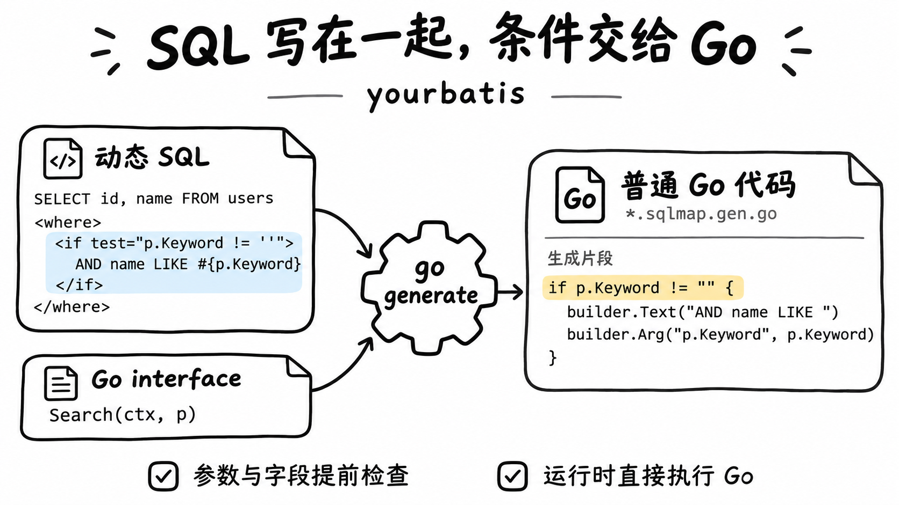

## 同一个方法，不同的 SQL

最常见的动态 SQL 需求，就是一个带可选筛选条件的列表。以用户搜索为例：

```go
type SearchUserParams struct {
    Keyword        string      // 为空表示不按名字筛选
    Status         *UserStatus // nil 表示不按状态筛选
    IDs            []int64     // 为空表示不限定 ID
    IncludeDeleted bool
    Limit          int
    Offset         int
}
```

每个筛选条件都是可选的，所以同一个方法在不同调用下要发出不同的 SQL：

```sql
-- 只传分页参数（默认排除已删除用户）
SELECT id, name, email, status, created_at FROM users
WHERE status != 'deleted'
ORDER BY created_at DESC LIMIT $1 OFFSET $2

-- 传入关键字、状态和两个 ID
SELECT id, name, email, status, created_at FROM users
WHERE name LIKE $1 AND status = $2 AND id IN ($3, $4)
ORDER BY created_at DESC LIMIT $5 OFFSET $6
```

条件个数、占位符编号、`WHERE` 后面的第一个 `AND`、`IN` 列表的长度，都会随参数变化。
这些细节并不难，但每一个都可能出错，而且通常要到某个特定的参数组合真正执行时才会
暴露出来。

MyBatis 的动态元素正适合表达这些变化。接下来看看 yourbatis 如何沿用这种写法，并把查询绑定到
一个 Go interface 上。它要求投影固定，也不对照数据库 schema 检查 SQL，这些边界会在后文说明。

## yourbatis 是什么

开头的图概括了它的用法：用 Go interface 定义参数和返回值，用 Mapper XML 写动态 SQL，
再生成实现该 interface 的 `.sqlmap.gen.go` 文件。XML 采用 MyBatis 写法的可静态验证子集。

一个最小的例子（简化自仓库中的 `example/user`）。先在 Go 里定义 interface：

```go
//go:generate go run github.com/superduck-ai/yourbatis/cmd/sqlmapgen -mapper UserMapper -sql ./user_mapper.xml -dialect postgres

type UserMapper interface {
    FindByEmail(ctx context.Context, email string) (User, bool, error)
    Search(ctx context.Context, params SearchUserParams) ([]User, error)
}
```


再在 XML 里为每个方法写一个同名的 statement：

```xml
<mapper namespace="UserMapper">
    <select id="FindByEmail" resultType="User">
        SELECT id, name, email, status, created_at
        FROM users
        WHERE email = #{email}
    </select>

    <select id="Search" resultType="User">
        SELECT id, name, email, status, created_at
        FROM users
        <where>
            <if test="params.Keyword != ''">AND name LIKE #{params.Keyword}</if>
            <if test="params.Status != nil">AND status = #{params.Status}</if>
        </where>
    </select>
</mapper>
```

运行 `go generate` 后，就可以像使用普通 Go 代码一样调用：

```go
db := yourbatis.NewDB(sqlDB, yourbatis.DialectPostgres)
users := user.NewUserMapper(db)

u, found, err := users.FindByEmail(ctx, "ada@example.com")
```

调用时执行的就是生成代码：XML 中的条件变成 Go 的 `if`，结果由固定的 `rows.Scan` 调用读取。

## 现有方案各自的取舍

理解了基本用法，再看 yourbatis 在现有 Go 数据访问方案中的位置。

直接使用 `database/sql`，或者加上 sqlx 这样的轻封装，可以保留完整的 SQL，执行过程也比较直接。
代价是动态条件需要手写拼接，SQL 和映射中的错误通常在运行时发现。

squirrel、goqu 这类 query builder 擅长组合动态条件，但查询会变成 Go 方法调用，错误也主要在
运行时发现。Jet、bob 这类类型安全 DSL 则能在编译期检查 DSL 层面的类型，仍然需要用 Go 代码
表达 SQL。

GORM、ent 这类 ORM 提供了更多数据访问能力，动态查询也方便，但 SQL 的可见程度取决于具体用法，
还需要理解框架的隐式行为。sqlc 选择了另一个方向：保留手写 SQL，在生成期检查并生成 Go 代码，
代价是动态 SQL 的表达能力有限。

sqlc 是这些方案中和 yourbatis 理念最接近的项目，下面单独展开。

### sqlc 做对了什么

sqlc 的核心思想很好：**开发者写 SQL，工具生成类型安全的 Go 代码。** 它会读取 schema
和查询，推断参数和结果的类型，把 `SELECT *` 展开成显式列名，并生成直接调用
`database/sql` 的代码。生成的代码没有反射，也没有运行时魔法。它能对照 schema 检查
SQL，这一点 yourbatis 目前做不到（后文会细说）。

### sqlc 的局限

sqlc 的取舍在于动态 SQL：查询结构基本固定，遇到可选筛选、动态排序或部分字段更新时，
往往需要把条件写进一条固定 SQL，或拆成多条查询。MyBatis 类方案则可以直接用条件和循环
组合 SQL，在这类需求上更灵活。yourbatis 希望保留这种灵活性，同时通过代码生成提前检查错误。

### 其他方案的局限

- **ORM** 最让我们反感的是，看着调用代码，却不知道最终执行了什么 SQL、执行了几条。
  查了哪些列、用了什么条件、有没有额外的关联查询，都要翻日志才能确认。我们希望 SQL 直接写在代码库里，
  审查时就能看清查询的意图和范围。
- **Query builder 和类型安全 DSL** 也有类似的问题：一条查询被拆成大量方法调用，散落在
  各个条件分支里。想看清完整 SQL，就得在脑子里把这些片段重新拼起来；条件越多，查询越不清晰。
- **运行时解析 XML 的 MyBatis 风格方案**保留了 SQL 的可读性和动态能力，但表达式
  在运行时解释，结果映射依赖反射，字段名拼错要到执行那一刻才暴露。

yourbatis 想做的，是把 MyBatis 的动态 SQL 表达力和 sqlc 的生成期确定性结合起来。

## yourbatis 如何工作

先换个角度看 Mapper XML：它其实是一段**程序**。输入是方法参数，输出是一条 SQL 加一组参数
值。`<if>` 是条件分支，`<foreach>` 是循环，`<bind>` 是变量声明，`test` 属性里写的是表达式。

MyBatis 用**解释器**运行这段程序：启动时，它把 XML 解析成一棵 SqlNode 树；此后每次调用 Mapper
方法，都要遍历这棵树，用 OGNL 求值表达式，用反射读取参数字段，再用反射把结果写回对象。yourbatis 走的是另一条路：它是一个
**编译器**，在 `go generate` 时把这段程序翻译成 Go，运行时只执行翻译后的结果。

代码生成让许多错误能在执行前暴露。下面沿着 `sqlmapgen` 的解析、检查和代码生成过程，
看看这些检查是怎样完成的。

### 两个阶段：哪些事在生成期确定

理解 yourbatis 的关键是分清两件事：生成期确定代码该怎样构建 SQL，运行期根据参数决定实际构建什么。

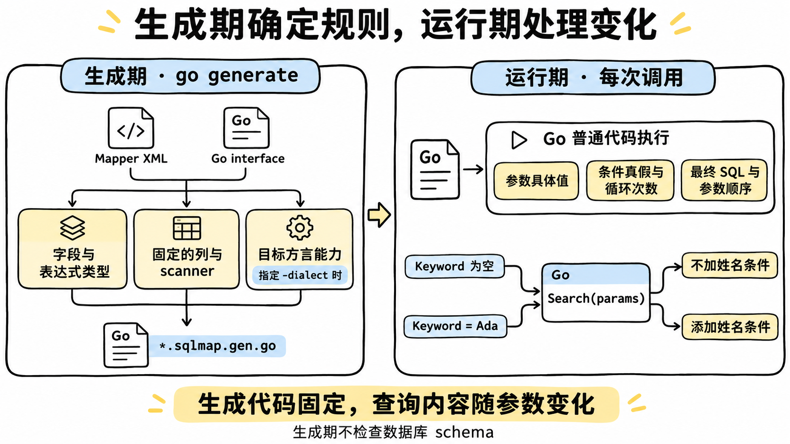

生成器处理完静态信息后，留下的就是普通 Go 构建函数。同一个函数可以生成不同的查询，
无需在每次调用时重新解析 XML。指定 `-dialect` 时，方言能力也会提前检查；否则留到运行期检查。

### 流水线总览

生成器把 XML 和 Go 类型信息汇合到语义分析，再完成表达式转换、结果映射和方言检查：

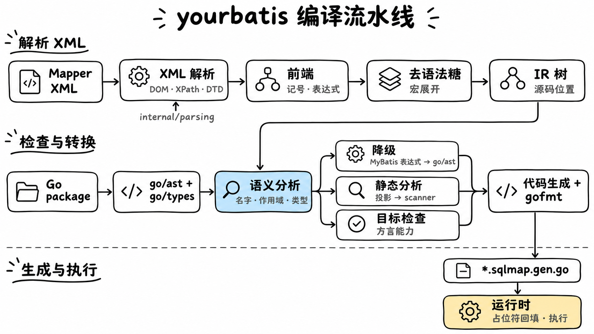


### 前端：三层解析

一份 Mapper XML 里嵌套着三种语言，前端要分三层解析：XML 结构、SQL 文本里的 `#{}`/`${}` 记号，
以及 `test` 等属性里的表达式。

#### 第一层：XML，以及一个自建的 DOM

MyBatis 依靠 JDK 的 DOM 和 XPath 读取 XML，而 Go 的 `encoding/xml` 没有这些能力。
为沿用 MyBatis 对空白、编码和实体的处理规则，yourbatis 在 `internal/parsing` 中移植了解析层。
下面用一条简单查询展示 XML 如何成为节点树：

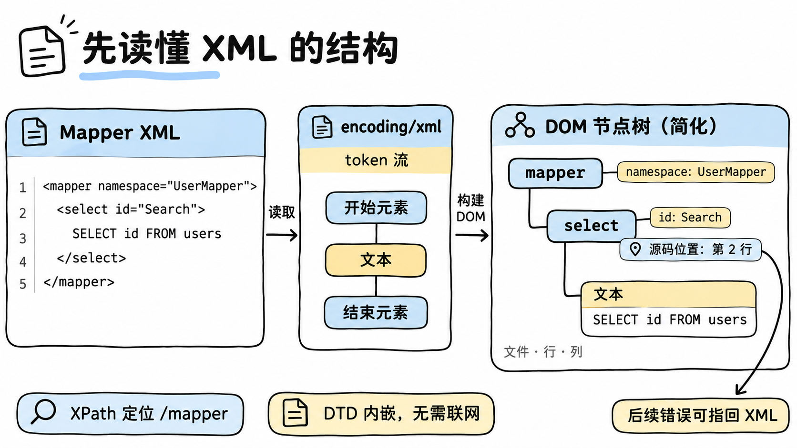

前端通过 XPath 定位 `/mapper` 后，便沿 DOM 读取属性、文本和子节点；内嵌 DTD 让生成过程无需联网。
这里有一个已知限制：SQL 文本中的自定义实体会被静默丢弃，例如 `FROM &tbl;`
会变成 `FROM `，应直接写出文本。`&lt;`、`&amp;` 等预定义实体不受影响。

在这一层之上，严格前端（`internal/frontend/xmlmapper`）把每个元素、属性和参数选项都当作白名单
处理。MyBatis 对未知属性通常比较宽容，yourbatis 则直接拒绝：

```text
./user_mapper.xml:23:65: <select> does not support attribute "useCache" in the Go-first XML dialect
```

被静默忽略的 `useCache="true"` 是一种虚假的承诺：读 XML 的人以为开启了缓存，实际上并没有。
我们宁愿让生成失败。

#### 第二层：SQL 文本中的记号

读出 SQL 文本后，前端继续识别其中的 `#{}` 和 `${}`，把普通文本、参数绑定和文本表达式分开保存：

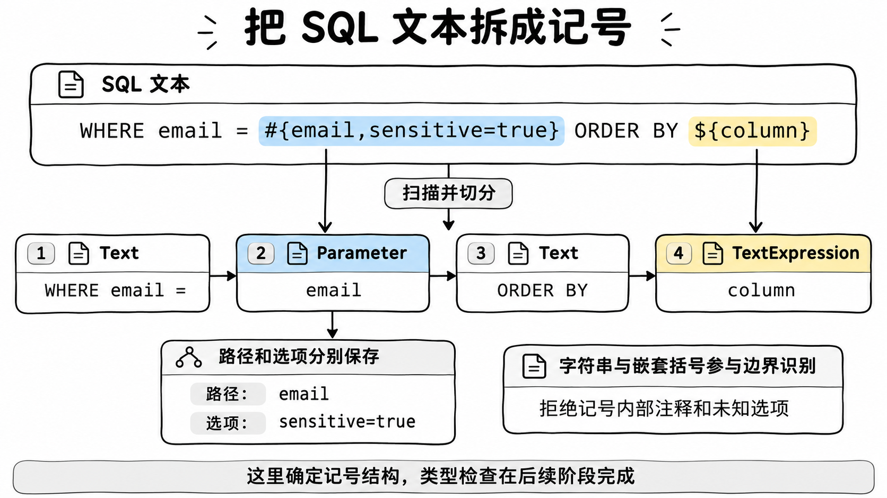

边界识别需要跟踪记号内部的字符串字面量和嵌套括号。切分后，参数路径和选项分别保存；
记号内部的注释、未知选项都会被拒绝。此时只确定结构，表达式是否合法还要交给后续的类型检查。

#### 第三层：表达式

`test`、`value`、`collection` 属性里的表达式有两种输入模式：

- **原生 Go 子集。** 如果表达式本身就是合法的 Go 表达式，就直接交给 `go/parser.ParseExpr`
  解析，再检查其中的函数调用是否在允许的范围内。新 Mapper 推荐使用这种写法，例如
  `params.Status != nil && len(params.IDs) > 0`。
- **MyBatis 兼容子集。** 当表达式中出现 `and`、`null`、`.size()`、`in {...}` 这类 MyBatis
  写法时，交给一个手写的**递归下降解析器**。它按运算符优先级逐层解析，每一层对应一个函数：
  三元表达式 → `or` → `and` → 比较（含 `in`/`not in`）→ 加减 → 乘除 → 一元运算 → 后缀（字段
  访问、方法调用、下标）→ 基本项。

两种模式分工明确：Go 写法是主要语言，兼容子集只为迁移已有的 MyBatis XML 而存在。

### 去语法糖与 IR

前端的输出是一棵很小的 IR 树（`internal/ir`）。MyBatis 的十几种动态元素，最后只剩 9 种节点：
`Text`、`Parameter`（`#{}`）、`TextExpression`（`${}`）、`If`、`Choose`、`Foreach`、`Trim`、
`Bind` 和 `SQLNodeBoundary`。

节点种类减少，主要靠去语法糖和宏展开：

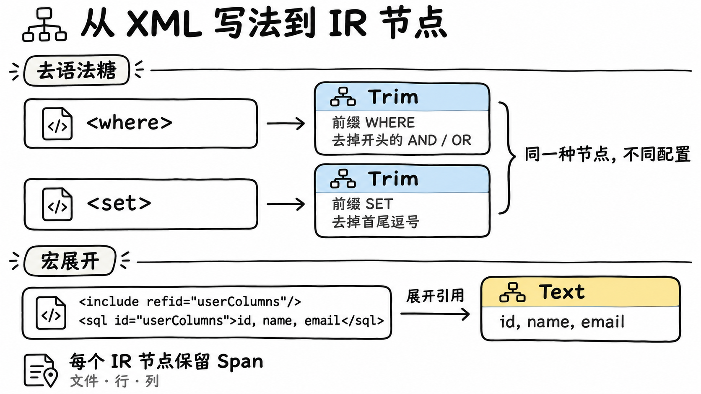

如图，后续阶段只需处理 `Trim` 及其配置，无需再分别识别 `<where>` 和 `<set>`。
`<include>` 也已被替换为对应片段；片段注册表拒绝重复的 `id`，避免后定义的内容覆盖前者。

节点上的 `Span` 让错误能指回 XML 的具体位置。XML、表达式和投影错误以 `文件:行:列` 开头；
少数 interface 与 XML 的绑定错误，例如 namespace 不匹配，只给出文件路径。

`SQLNodeBoundary` 是唯一一个不对应 XML 元素的节点。MyBatis 在拼接动态 SQL 时，每次调用
`appendSql` 都会插入一个空格。yourbatis 在 IR 里显式记录这些边界，让生成的 SQL 在空白处理上与
MyBatis 保持一致，在已迁移的用例上可以逐字符比较 SQL 文本。

### 语义分析：名字、作用域与类型

语法正确不代表程序有意义。语义分析要回答三个问题：每个名字指向什么？它的类型是什么？这样
使用是否合法？

#### 符号从哪里来

生成器用 `go/parser` 直接读取目标包的源码 AST，从中取得 Mapper interface 的方法签名，以及
struct 的导出字段和 `db`/`sqlmap` tag。`golang.org/x/tools/go/packages` 只在两处用到：解析
import 对应的真实包名，以及在需要时加载 `go/types` 信息（例如处理 resultMap 涉及的嵌入字段）。
读取时会跳过已有的 `*.sqlmap.gen.go`，所以生成结果不依赖上一次的产物，即使旧的生成文件已经
损坏也能重新生成。

表达式里可以引用的名字有这几类：

- 方法参数（例如 `params`、`id`）；
- 只有一个参数时的兼容别名 `_parameter`；
- 来自 `WithDatabaseID` 的 `_databaseId`；
- `<bind>` 声明的变量；
- `<foreach>` 的 `item` 和 `index`。

#### 作用域链

作用域沿父指针从内向外查找名字。图中展示了方法参数、条件分支和循环变量的可见范围：

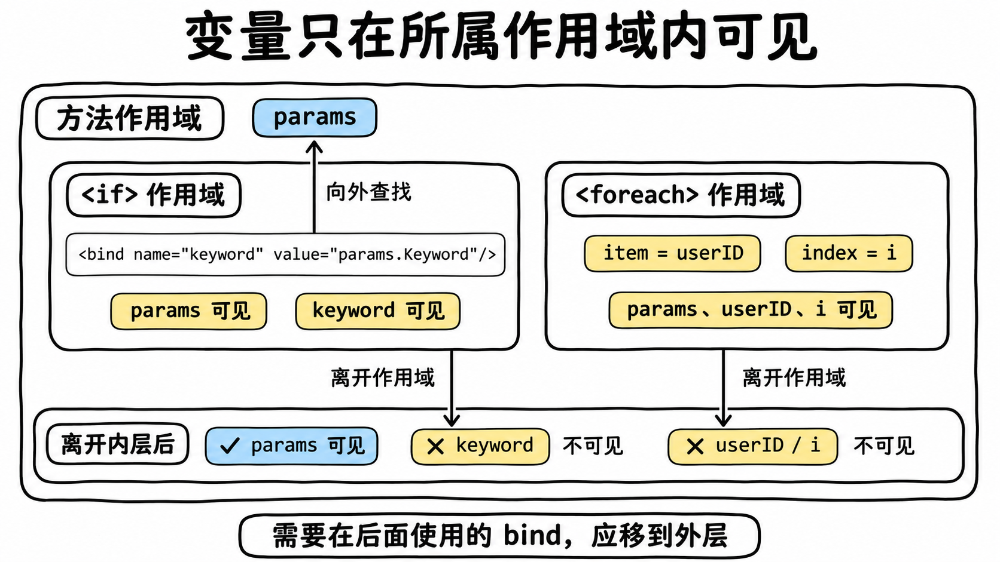

`<when>`、`<otherwise>` 也各自建立作用域，`<trim>`、`<where>`、`<set>` 则不开新作用域。
这套规则让生成器能发现越界引用，例如在循环外使用 `userID`：

```text
./user_mapper.xml:77:31: invalid if test "userID > 0": unknown identifier "userID"
```

第二类是在同一作用域里重复声明：

```text
./user_mapper.xml:53:107: bind name "keyword" is already declared in this scope
```

这与 MyBatis 的 statement 共享上下文不同：MyBatis 中重复 bind 会覆盖旧值，`<if>` 内 bind 的变量
在分支之后仍可见。迁移时，需要在后续使用的 `<bind>` 应移到外层。

#### 类型推断与类型检查

作用域里存放的不只是名字，还有类型。`<bind name="keyword" value="params.Keyword"/>` 中的
`keyword` 没有显式写出类型，生成器从右侧表达式推断出它是 `string`。后续对 `keyword` 的每一次
使用，都会按 `string` 来检查：

```text
./user_mapper.xml:54:43: invalid if test "keyword != nil": type string cannot be compared with nil; use a pointer for nullable values or compare against an explicit value
```

字段访问同样会经过检查：

```text
./user_mapper.xml:52:44: invalid if test "params.Keywrd != ''": type SearchUserParams has no exported field "Keywrd"
```

这条检查对迁移尤其重要。Java 的 `String` 可以为 null，`name != null` 是有意义的判断；到了 Go，
`string` 的零值是 `""`，`nil` 根本不是合法值。yourbatis 因此拒绝 `string != nil`，要求用
`!= ""` 表达空串；需要表达"不存在"时，参数类型应该是 `*string`。

#### `${}`：由类型决定能生成什么

`#{}` 把值交给驱动绑定，`${}` 则直接改变 SQL 文本。以查询条件和动态排序列为例，两条路径的区别如下：

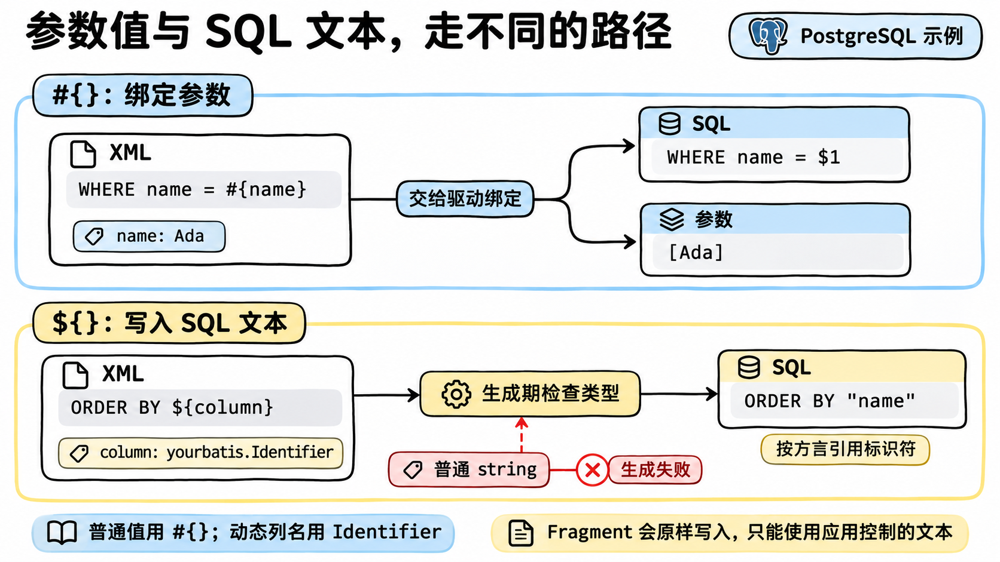

`${}` 还接受数值和 `bool`，由对应的 `AppendSigned`、`AppendUnsigned`、`AppendFloat`、`AppendBool`
输出；`Fragment` 则原样写入，约定通过 `TrustedFragment` 构造。普通 `string`、指针、`any` 和
interface 类型都会导致生成失败，例如：

```text
./user_mapper.xml:107:2: unsafe text expression "column": plain string interpolation is disabled; use #{} binding, yourbatis.Identifier, or yourbatis.Fragment
```

这是类型系统的典型用法：把"这段文本可以进入 SQL"变成签名的一部分，让代码审查能够看见。要动态
指定排序字段，就把参数声明为 `yourbatis.Identifier`，并用 `NewIdentifier` 构造，它会校验标识符
的格式。


#### 函数签名也是类型

每个 interface 方法要和 XML 中同名的 statement 链接起来，这一步类似于编译器把声明和定义对应
起来。链接时，生成器从**函数签名**推断结果语义：

- `(T, error)` 表示 `one`，要求恰好一行。零行返回 `sql.ErrNoRows`，一行返回 `T`，
  多行返回 `ErrTooManyRows`。
- `(T, bool, error)` 表示 `optional`，允许查不到。零行返回 `zero, false, nil`，
  一行返回 `T, true, nil`，多行仍返回 `ErrTooManyRows`。
- `([]T, error)` 表示 `many`，返回所有结果组成的 slice；零行时返回空 slice。
- `(..., yield func(T) error) error` 表示 `each`，逐行调用回调；零行时不调用回调并返回 `nil`。

INSERT/UPDATE/DELETE 只返回 `error` 时推断为 `exec`，返回 `(int64, error)` 时推断为 `rows`。
`returning` 和 `lastid` 必须在 XML 里显式声明，原因见后文的目标检查。签名不合法时，生成直接
失败：

```text
./user_mapper.xml:30:53: UserMapper.FindByEmail: optional select methods must return (T, bool, error)
```

调用方只读 interface，就能知道"查不到"是一个错误还是一个正常分支。

#### 检查的边界：两层类型检查

yourbatis 的类型检查实际上分两层：生成器负责它最了解的部分，并给出指向 XML 的错误位置；
Go 编译器在 `go build` 时兜底，保证生成的代码类型正确。代价是第二层报错指向的是生成文件，
而不是 XML。把更多检查前移到第一层，是我们接下来的改进方向。

### 把 MyBatis 条件转换成 Go

为了方便迁移，yourbatis 支持一部分 MyBatis 表达式写法。例如，判断状态已传入、ID 列表非空：

```xml
<if test="params.Status != null and params.IDs.size() > 0">
```

生成器会把它转换成普通的 Go 条件：

```go
if params.Status != nil && len(params.IDs) > 0 {
```

这里的 `null` 变成 `nil`，`and` 变成 `&&`，`.size()` 变成 `len()`。转换在生成期完成，
运行时直接执行 Go 代码。

兼容范围有限，不支持完整的 OGNL。新写的 Mapper 可以直接使用 Go 条件，无需经过这类转换。

### 静态分析：从 SQL 文本中提取投影

投影就是查询返回的列清单。yourbatis 在生成期把列名与 Go 字段对应起来，生成按固定顺序扫描的代码。
图中以 `db` tag 映射为例：

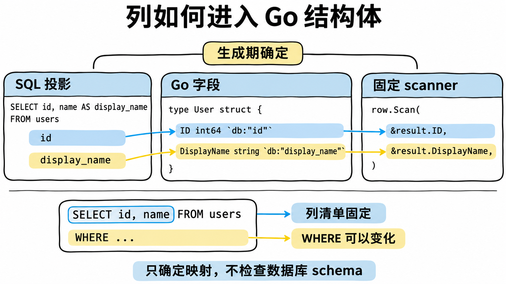

为提取这些列，生成器使用一个轻量扫描器：

1. 定位**顶层**的 `SELECT ... FROM` 或 `RETURNING` 子句，扫描时跳过字符串字面量、注释和括号内
   的子查询；
2. 按顶层逗号切分投影项；
3. 每一项必须是简单的列引用（`name`、`u.name`），或者带显式 `AS` 别名的表达式。
   `result="scalar"` 是例外：唯一的投影项可以不带别名，按位置扫描；
4. 通过 `resultMap`、`db`/`sqlmap` tag 或字段名，把列映射到结构体字段。

这一步只提取映射所需的信息，不做完整的 SQL 语法和 schema 校验，避免为各数据库实现一套 SQL 解析器。

这一步的规则都对应着清晰的错误信息：

```text
./user_mapper.xml:23:49: SELECT * cannot be statically mapped; list columns explicitly
```

```text
./user_mapper.xml:38:50: column "user_ident" cannot be mapped to UserLabel; add a db tag, alias, or resultMap
```

```text
./user_mapper.xml:40:31: dynamic <if> cannot change the SELECT projection; generated scanners require a fixed column list
```

最后一条解释了图中的边界：投影一旦随参数变化，就无法复用同一套固定的 scanner，因此生成器会拒绝它。

### 代码生成：遍历 IR，输出 Go

到这里，名字和类型已确定，表达式也已转换为 Go。生成器按 IR 的嵌套结构输出语句：

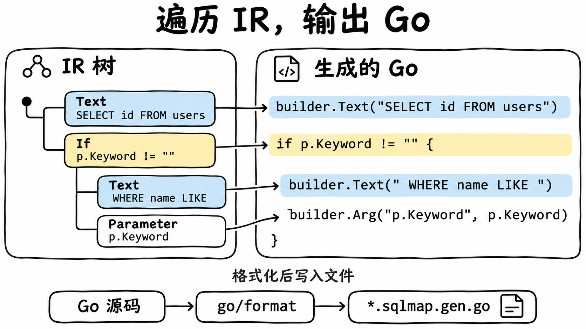

图中展示了文本、条件和参数的对应关系。其余节点也按同样的方式处理：`Choose` 生成条件链，
`Foreach` 生成循环，`Bind` 生成局部变量，`Trim` 使用子 builder 和 `AppendTrimmed`。

以开头的搜索接口为例，XML 写成：

```xml
<select id="Search" resultType="User">
    SELECT <include refid="userColumns"/>
    FROM users
    <where>
        <if test="params.Keyword != ''">
            <bind name="keyword" value="params.Keyword"/>
            AND name LIKE #{keyword}
        </if>
        <choose>
            <when test="params.Status != nil">
                AND status = #{params.Status}
            </when>
            <otherwise>
                <if test="!params.IncludeDeleted">
                    AND status != 'deleted'
                </if>
            </otherwise>
        </choose>
        <foreach collection="filterPositiveUserIDs(params.IDs)" item="userID"
                 open="AND id IN (" separator="," close=")">
            #{userID}
        </foreach>
    </where>
    ORDER BY created_at DESC
    LIMIT #{params.Limit} OFFSET #{params.Offset}
</select>
```

下面是生成的构建函数。为了便于阅读，这里给出的是**整理过的等价形式**：真实的生成代码在 `Text`
中保留了 XML 原有的换行和缩进，也带有 `BeginSQLNode` 标记。完整代码见
`example/user/user_mapper.sqlmap.gen.go`。

```go
func buildUserMapperSearch(dialect yourbatis.Dialect, params SearchUserParams) yourbatis.BoundSQL {
    builder := yourbatis.NewBuilder(dialect)
    builder.Text("SELECT id, name, email, status, created_at FROM users")

    trim1 := yourbatis.NewBuilder(dialect)
    if params.Keyword != "" {
        keyword := params.Keyword
        trim1.Text("AND name LIKE ")
        trim1.Arg("keyword", keyword)
    }
    if params.Status != nil {
        trim1.Text("AND status = ")
        trim1.Arg("params.Status", params.Status)
    } else {
        if !params.IncludeDeleted {
            trim1.Text("AND status != 'deleted'")
        }
    }

    foreach2 := yourbatis.NewBuilder(dialect)
    for index, userID := range filterPositiveUserIDs(params.IDs) {
        itemSQL3 := yourbatis.NewBuilder(dialect)
        itemSQL3.Arg("userID", userID)
        foreach2.AppendSeparated(itemSQL3, ",")
    }
    if foreach2.HasIterations() {
        trim1.Text("AND id IN (")
        trim1.Append(foreach2)
        trim1.Text(")")
    }

    builder.AppendTrimmed(trim1, "WHERE ", []string{"AND ", "OR ", /* ... */}, "", nil)
    builder.Text("ORDER BY created_at DESC LIMIT ")
    builder.Arg("params.Limit", params.Limit)
    builder.Text(" OFFSET ")
    builder.Arg("params.Offset", params.Offset)
    return builder.Build()
}
```

这里的 `filterPositiveUserIDs` 是包内的普通 Go 函数，因此编辑器跳转、重构和 `go vet` 都能照常工作。

生成器给内部变量按顺序编号命名（`trim1`、`foreach2`、`itemSQL3`），并避开方法参数以及
`<bind>`、`<foreach>` 声明的名字，防止与用户写的名字冲突。最终源码经过 `go/format` 格式化，同样的输入总是产出逐字节相同的输出，
便于把生成文件提交到版本库并参与代码审查。

### 检查数据库能力

不同数据库支持的结果模式不同：`returning` 支持 PostgreSQL 和 SQLite，`lastid` 支持 SQLite
和 MySQL。使用时需要在 XML 中显式声明，yourbatis 不会自动切换模式。

指定 `-dialect` 后，不支持的模式在生成期报错；未指定时，则在运行期执行 SQL 之前检查。
例如 PostgreSQL 不支持 `lastid`，必须在 INSERT 执行前拒绝，避免写入后才报错。

### 运行时：很薄的一层

生成代码只依赖一个包含三个方法的 interface：

```go
type Executor interface {
    Dialect() Dialect
    Query(context.Context, Statement, BoundSQL) (*sql.Rows, error)
    Exec(context.Context, Statement, BoundSQL) (sql.Result, error)
}
```

`*yourbatis.DB` 和 `*yourbatis.Tx` 都实现了它。运行时库的其余部分，是一组泛型辅助函数：
`SelectOne`、`SelectOptional`、`SelectMany`、`SelectEach`、`ExecuteRows`、`ExecuteLastInsertID`。
它们负责调用 `database/sql`、执行生成好的 scanner、落实行数语义。单行查询会多读一次，确认没有
第二行，有就返回 `ErrTooManyRows`，而不是静默丢弃多余的行。

事务没有隐式行为。Mapper 绑定在哪个 executor 上，就在哪个连接上执行：

```go
err := db.Transaction(ctx, func(tx yourbatis.Executor) error {
    users := user.NewUserMapper(tx)
    roles := role.NewRoleMapper(tx)
    if _, err := users.UpdateStatus(ctx, id, user.UserStatusActive); err != nil {
        return err
    }
    return roles.Grant(ctx, id, roleID)
})
```

我们没有通过 `context.Context` 传递事务。读代码的人只要看 Mapper 是用 `db` 还是 `tx` 构造的，
就知道这次调用属于哪个事务。

错误会被包装成 `*yourbatis.StatementError`，携带 statement ID 和 XML 来源位置，同时不影响
`errors.Is(err, sql.ErrNoRows)` 这样的标准判断。日志接口能拿到最终 SQL、参数和耗时；标记为
`#{email,sensitive=true}` 的参数，在调试输出中显示为 `<redacted>`。

最后说一下运行时开销。生成代码和运行时库都不使用反射，也不在运行时解析 XML 或解释表达式。

## 开发体验：在 Go 和 XML 之间跳转

API 写在 Go 里、SQL 写在 XML 里，同一个方法就被分到了两个文件中。IDE 自带的跳转帮不上忙：在
GoLand 里对 `UserMapper.Search` 使用 **Go to Implementation**，会跳到生成的
`user_mapper.sqlmap.gen.go`。这个结果没有错，但开发者真正要改的是 XML。

为此，仓库附带了一个约 700 行的 GoLand/IntelliJ IDEA 插件（`jetbrains-plugin/`）。在 interface
名称或方法旁点击 gutter 图标，可以跳到对应的 `<mapper>` 或 statement；在 XML 那边点击，可以跳回
Go。下图左侧展示 Go 到 XML 的入口，右侧展示 XML 到 Go 的入口，红色箭头指向插件的导航图标。

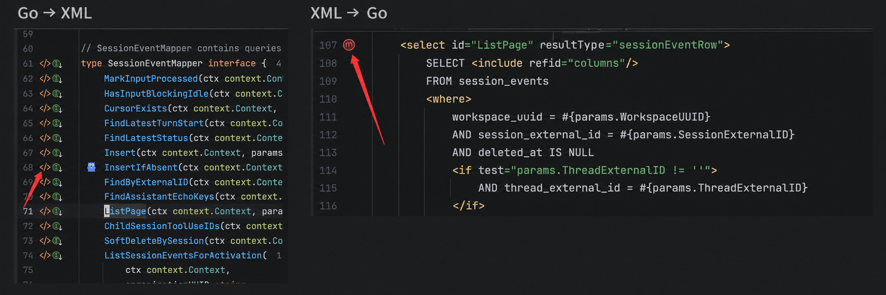

namespace 写简单名称或限定名称都能识别，匹配到多个目标时会弹出列表供选择。

## 小结

yourbatis 有明确的边界。有些是"暂未实现"，更多是刻意的设计选择。

- **它不检查 SQL 是否符合数据库 schema。** sqlc 能告诉你 `users` 表没有 `emial` 列，
  yourbatis 不能。它检查的是 SQL 和 Go 之间的契约（字段、类型、投影和签名），而不是
  SQL 和数据库之间的契约。类型不匹配会在 `rows.Scan` 时以运行时错误的形式出现。
- **它不是完整的 MyBatis。** 不支持 `association`/`collection` 等嵌套对象图、缓存、懒加载、`selectKey`、`parameterMap`、存储过程，也不支持跨文件的 SQL 片段。


项目已开源：[github.com/superduck-ai/yourbatis](https://github.com/superduck-ai/yourbatis)。 欢迎 Star 😄。
